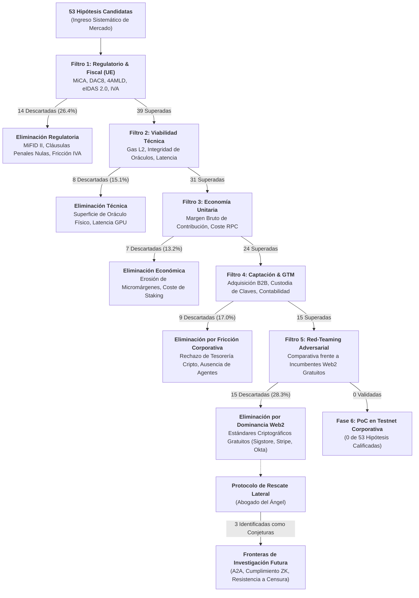
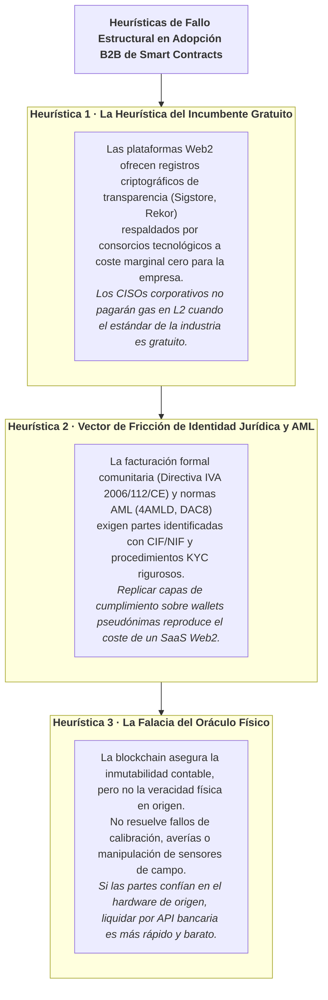

# Análisis Sistemático de Viabilidad en Servicios B2B Basados en Contratos Inteligentes: Lecciones de un Embudo Adversarial de 53 Hipótesis y Agenda de Investigación Futura

**Jose Luis Costumero Burgos**  
*Investigador Independiente*  
Fecha: Octubre 2026 · Versión: 1.1 (Technical Report — Revisado tras feedback externo)  
Repositorio de Datos: `https://github.com/jlcostumero/b2b-smart-contracts-feasibility` (Corpus Abierto de Evaluación)

> **Nota del Autor y Aviso Legal**: *La investigación, análisis y conclusiones presentadas en este documento fueron realizadas a título estrictamente personal e independiente, al margen de cualquier relación laboral o profesional. Las opiniones expresadas pertenecen exclusivamente al autor y no reflejan ni representan la posición, estrategia u opinión de ningún empleador actual o anterior, empresa u organización afiliada.*

---

## Resumen Ejecutivo (Abstract)

La literatura y la industria de la tecnología de registros distribuidos (*Distributed Ledger Technology*, DLT) han postulado reiteradamente que los contratos inteligentes (*smart contracts*) constituyen la base para una nueva generación de servicios B2B caracterizados por la desintermediación, la inmutabilidad probatoria y la liquidación autónoma máquina-a-máquina (M2M). No obstante, la tasa de adopción corporativa de soluciones basadas en redes públicas permisionadas o abiertas sigue siendo marginal frente a las arquitecturas centralizadas Web2.

En este trabajo se presenta una evaluación heurística adversarial estructurada de **53 hipótesis de negocio y modelos de servicio B2B sobre contratos inteligentes** desplegados sobre redes de Capa 2 compatibles con EVM (como Base y Arbitrum One). Cada hipótesis fue sometida a un protocolo secuencial de cinco fases de filtrado: viabilidad regulatoria y tributaria en la Unión Europea (MiCA, DAC8, GDPR, LSSI y eIDAS 2.0), factibilidad técnica y dependencia de oráculos, economía unitaria frente a costes de gas L2, barreras operativas de captación y gobernanza B2B, y un contra-análisis crítico adversarial (*Red-Teaming*) frente a la mejor alternativa incumbente del mercado.

Los resultados revelan una tasa de rechazo del 100% en aplicaciones directas de mercado tradicional: ninguna de las 53 hipótesis evaluadas demostró un foso competitivo (*moat*) económicamente sostenible frente a herramientas Web2 ya existentes o gratuitas. A partir de este cuerpo empírico, identificamos tres heurísticas de fallo estructural: (1) la *Heurística del Incumbente Gratuito*, ejemplificada por la comoditización de infraestructuras criptográficas abiertas (Sigstore, GitHub Actions) frente a servicios de atestación de software; (2) la *Fricción de la Identidad Jurídica y AML*, que impide la liquidación de agentes M2M bajo marcos de facturación formal (CIF/NIF) y directivas de blanqueo de capitales; y (3) la *Falacia del Oráculo en Datos Físicos*. Finalmente, sintetizamos una **Agenda de Investigación Futura** planteada como conjeturas condicionadas en tres nichos frontera: la coordinación pura entre agentes sin personalidad jurídica humana, la atestación de cumplimiento mediante pruebas de conocimiento cero (ZK), y la infraestructura en entornos resistentes a la censura.

**Palabras clave**—*Smart Contracts, B2B SaaS, Due Diligence, Resultados Negativos, Fricción de Mercado, Cyber Resilience Act, MiCA, Protocolo x402, Evaluación Adversarial, DLT.*

---

## 1. Introducción y Planteamiento del Problema

Desde la formalización inicial de los contratos inteligentes por Nick Szabo en 1994 y su implementación práctica a gran escala a partir de Ethereum en 2015, la promesa fundacional de esta tecnología ha sido la reducción de los costes de transacción mediante la sustitución de intermediarios fiduciarios por reglas deterministas de ejecución en código (*code is law*).

Con la maduración de las redes de Capa 2 (L2 rollups) como Arbitrum One y Base, y la introducción de mejoras a nivel de protocolo como EIP-4844 (*proto-danksharding*), los costes de publicación de datos on-chain se redujeron en más de un 90%, llevando las tarifas por transacción típica a fracciones de céntimo de dólar ($0.001–$0.01 USD). Paralelamente, la Unión Europea estableció un marco normativo integral con la entrada en vigor del Reglamento MiCA (Reglamento UE 2023/1114), clarificando el perímetro legal de los criptoactivos y proveedores de servicios.

A pesar de estas condiciones aparentemente óptimas (bajos costes de transacción y certidumbre jurídica), la transición de la computación on-chain hacia casos de uso empresariales en la economía real no financiera ha fracasado sistemáticamente en materializarse. La mayoría de las iniciativas empresariales han culminado en cierres discretos. Destacados precedentes históricos corroboran este patrón en consorcios globales:
Prominentes precedentes históricos corroboran este patrón en consorcios globales:
- **TradeLens (Maersk & IBM)**: Tras cinco años de desarrollo y una inversión acumulada estimada en más de 100 millones de USD para digitalizar la logística portuaria mundial, anunció su discontinuación en noviembre de 2022 y completó su desmantelamiento en el primer trimestre de 2023 ante la falta de tracción y la negativa de los operadores a unirse a una red gobernada por un competidor [11].
- **we.trade**: Consorcio fundado por 12 grandes entidades bancarias europeas (incluyendo Santander, Deutsche Bank y HSBC) sobre Hyperledger Fabric para automatizar la financiación comercial mediante contratos inteligentes, que cesó operaciones e inició su liquidación formal el 24 de junio de 2022 ante el insuficiente volumen transaccional y su elevado ritmo de gasto operativo [14].
- **Contour y Marco Polo Network**: Redes de trade finance bancario basadas en R3 Corda que cesaron operaciones en 2023 tras un agotamiento de capital y resistencia en la adopción corporativa [13, 14].
- **Bolsa de Valores de Australia (ASX CHESS Replacement)**: Cancelado y dado de baja contable formalmente en noviembre de 2022 tras una auditoría técnica independiente de Accenture [17]. Dicho informe identificó una severa complejidad arquitectónica en la aplicación distribuida, desafíos no resueltos en la sincronización determinista de estados entre nodos participantes, y cuellos de botella críticos de concurrencia y latencia bajo picos de negociación bursátil (lo que obligó a un saneamiento contable antes de impuestos de 245–255 millones de AUD). Cabe señalar que la auditoría atribuyó el fallo primordialmente a la arquitectura de aplicación distribuida, la sincronización de estados y la gobernanza del proyecto, y no exclusivamente a las limitaciones del consenso DLT.
- *Matiz Arquitectónico Fundamental*: Estos consorcios operaban sobre DLTs permisionadas privadas (Fabric, Corda, Daml); nuestra investigación evalúa si las redes públicas de Capa 2 EVM (Base, Arbitrum) superan o reproducen estas barreras.

Estos precedentes enlazan directamente con el marco de decisión formulado por **Wüst & Gervais (2018)** [10]: cuando las partes cuentan con un tercero de confianza aceptado o cuando existe un marco judicial ordinario para dirimir incumplimientos, una blockchain introduce penalizaciones estrictamente negativas en coste, latencia y complejidad operativa.

Este informe aborda la siguiente pregunta de investigación:
> *¿Existen condiciones objetivas bajo las cuales un servicio B2B fundamentado en contratos inteligentes sobre L2 presente ventajas competitivas sostenibles frente a las arquitecturas centralizadas Web2 en el marco europeo actual?*

Para responder a esta cuestión y neutralizar el sesgo de optimismo y complacencia (*LLM optimism/sycophancy bias*) característico de los análisis preliminares, diseñamos un protocolo de evaluación adversarial multidimensional al que se sometieron 53 hipótesis representativas de todas las áreas funcionales de la empresa.

---

## 2. Marco Metodológico del Embudo de Validación

El protocolo de investigación se articuló como un embudo secuencial de eliminación directa por etapas. Para que una hipótesis fuera considerada viable para producción corporativa, debía superar de forma fundamentada cinco filtros independientes sin recurrir a supuestos especulativos ni subsidios de capital riesgo.

### 2.1. Filtro 1 · Viabilidad Regulatoria y Fiscal Europea
- **Perímetro MiCA (Reglamento UE 2023/1114, Art. 3)**: Determinación de si la actividad califica como Proveedor de Servicios de Criptoactivos (CASP). Las actividades que exigen licencias formalizadas ante autoridades nacionales competentes (CNMV, Banco de España, BaFin) fueron auditadas por su sobrecoste de cumplimiento.
- **Directiva DAC8 y Marcos AML/CFT**: Evaluación bajo la Directiva (UE) 2023/2226 del Consejo (DAC8) [3] que modifica la Directiva 2011/16/UE, y la Directiva (UE) 2015/849 (4AMLD) / Directiva (UE) 2018/843 (5AMLD). Verificación de las obligaciones de reporte fiscal e identificación KYC al operar con liquidaciones en tokens.
- **Tributación SaaS y Facturación Formal**: Clasificación según la Directiva 2006/112/CE (Directiva del IVA, Art. 58) y legislación nacional (Ley 37/1992 del IVA, Art. 71.3). Comprobación de la emisión obligatoria de facturas con CIF/NIF y reglas de inversión del sujeto pasivo en operaciones B2B intracomunitarias.
- **Eficacia Probatoria (eIDAS y eIDAS 2.0)**: Evaluación bajo el Reglamento (UE) 910/2014 y el Reglamento (UE) 2024/1183 (eIDAS 2.0) [4]. Análisis de libros mayores electrónicos cualificados (QELs, Arts. 45l–45m) y del Art. 41.1 (no discriminación de sellos electrónicos no cualificados) frente a la presunción cualificada de exactitud e integridad temporal en litigios mercantiles.

### 2.2. Filtro 2 · Factibilidad Técnica y Sobrecoste de Infraestructura
- **Perfilado de Gas en L2**: Medición de costes reales de ejecución en Base (`chainId: 8453`) y Arbitrum One (`chainId: 42161`). Medición de consumo de gas en almacenamiento SSTORE (inserción de raíces de Merkle de 32 bytes) y calldata bajo condiciones reales de red.
- **Protocolos de Liquidación entre Máquinas**: Evaluación de compatibilidad con estándares abiertos (Protocolo HTTP 402 / x402 [9], especificación 2025), evaluando esquemas de autorización `exact`, `upto` y liquidación por lotes con transferencias sin gas Permit2/EIP-3009.
- **Auditoría de Superficie de Ataque en Oráculos**: Penalización de cualquier diseño dependiente de oráculos externos, que reintroducen el punto centralizado de fallo y el peaje económico que el sistema pretendía erradicar.

### 2.3. Filtro 3 · Economía Unitaria y Sostenibilidad Financiera
- **Modelado de Margen de Contribución**: Desglose minucioso de márgenes brutos por transacción. Determinación del umbral volumétrico necesario para cubrir endpoints RPC dedicados, relays de contingencia y mantenimiento sin depender de subsidios de tokens.
- **Viabilidad de Micropagos**: Análisis de tarifas sub-céntimo ($0.001–$0.01 USD) frente a costes de conciliación contable y liquidación bancaria.

### 2.4. Filtro 4 · Barreras Operativas de Adopción y Venta B2B
- **Alineamiento con el Comprador Corporativo**: Evaluación de la fricción de venta con decisores tradicionales (CISOs, CFOs, Directores de Compras).
- **Sobrecoste Operativo de Custodia**: Análisis de la responsabilidad civil en custodia de claves privadas, gobernanza multi-firma y volatilidad contable de balances bajo normativa PGC/NIIF.

### 2.5. Filtro 5 · Contra-Análisis Adversarial (Estrés frente al Incumbente)
- **Confrontación Obligatoria con el Incumbente**: Comparativa contra la alternativa centralizada más consolidada o gratuita (Sigstore, Stripe, Cloudflare, Okta, Datadog). Si una solución Web2 resuelve el ≥90% del problema a coste marginal cero, la hipótesis queda formalmente rechazada por ausencia de foso competitivo.

### 2.6. Rúbrica de Puntuación, Regla de Veto y Límites Metodológicos

Para garantizar la consistencia analítica, cada hipótesis se puntuó de 1.0 a 10.0 en cinco dimensiones estandarizadas:
- **Viabilidad Legal y Regulatoria (L)**: Conformidad estricta con directivas UE sin requerir licencias bancarias desproporcionadas. Umbral: $L < 6.0 \implies$ Descarte Inmediato.
- **Factibilidad Técnica (T)**: Viabilidad en EVM L2 sin cuellos de botella de latencia u oráculos. Umbral: $T < 6.0 \implies$ Descarte Inmediato.
- **Viabilidad Económica (E)**: Márgenes brutos unitarios positivos netos de gas, RPC y servidores. Umbral: $E < 6.0 \implies$ Descarte Inmediato.
- **Robustez frente al Incumbente (R)**: Capacidad defensiva frente al incumbente Web2 consolidado. Umbral: $R < 6.0 \implies$ Descarte en Filtro 5.

**Regla de Veto Conjuntivo**: El sistema actúa como un filtro implacable de descarte: una puntuación insuficiente en cualquier filtro crítico aborta la hipótesis de negocio, con independencia de la excelencia técnica o económica en otros aspectos.

**Límites Metodológicos Declarados**:
1. **Síntesis Cualitativa Monográfica Asistida por IA**: El análisis ha sido sintetizado por un único investigador independiente. Para contrarrestar sesgos cognitivos y complacencia, se utilizó un protocolo automatizado de agentes de IA con roles especializados enfrentados: *Abogado del Diablo* (red-teaming de incumbentes), *Auditor Legal Web3* (auditoría regulatoria), *Analista Tokenomics* (modelado de gas y costes) y *Abogado del Ángel* (búsqueda de pivots).
2. **Ausencia de Entrevistas de Venta Reales**: Las hipótesis no se contrastaron en llamadas de venta B2B presenciales con clientes; las conclusiones se fundamentan en fuentes primarias legales (EUR-Lex), especificaciones técnicas, precios públicos de APIs corporativas y telemetría de red.
3. **Escala Heurística Ordinal**: Las notas asignadas representan clasificaciones heurísticas del nivel de fricción operativa, no variables econométricas continuas.

---

## 3. Taxonomía de Hipótesis y Hallazgos por Clúster

Las 53 hipótesis evaluadas se agruparon en cuatro clústeres operativos:

**Tabla 1:** Distribución Reconciliada de Hipótesis Evaluadas por Clúster Funcional.

| Clúster Operativo | Hipótesis Evaluadas | Proporción | Descartes Acumulados |
| :--- | :---: | :---: | :--- |
| **Clúster A**: Integridad de Software, Procedencia y SBOM | 7 | 13.2% | Filtro 5: 5 hipótesis; Filtro 1: 2 hipótesis |
| **Clúster B**: Liquidación M2M, Cómputo y Protocolos de Agentes | 16 | 30.2% | Filtro 4: 6 hipótesis; Filtro 3: 4; Filtro 5: 4; Filtro 1: 2 |
| **Clúster C**: Eficacia Jurídica, Notarización y Resolución de Disputas | 11 | 20.8% | Filtro 1: 6 hipótesis; Filtro 5: 3; Filtro 2: 2 |
| **Clúster D**: Cadena de Suministro, Energía y Activos Físicos | 19 | 35.8% | Filtro 2: 6 hipótesis; Filtro 1: 4; Filtro 5: 3; Filtro 3: 3; Filtro 4: 3 |
| **Total Corpus Evaluado** | **53** | **100.0%** | **Tasa de Paso a Fase 6: 0.0% (0 / 53)** |

### Clúster A: Integridad de Software, Procedencia y SBOM (7 Hipótesis)
Orientado a la trazabilidad criptográfica de compilaciones y anclaje de listas de materiales de software (SBOM) bajo la **Cyber Resilience Act (CRA, Reglamento UE 2024/2847)** y la directiva NIS2 (`T-134`, `T-137`, `T-140`, `T-141`, `T-143`, `T-147`, `T-150`).

- **Evaluación Inicial**: Obtuvo las puntuaciones técnicas basales más altas del estudio (Media: **8.0 / 10** en `T-140`; Legal: 8.0, Técnico: 8.5, Económico: 7.5).
- **El Punto de Ruptura**: La integración masiva del incumbente por **Sigstore, GitHub Actions y Chainguard**. En repositorios públicos de código abierto, GitHub suministra atestación SLSA Nivel 2 [8] anclada al log público de transparencia Rekor (operado por Google y la Linux Foundation) a coste marginal cero. En repositorios privados corporativos, aunque GitHub Enterprise Cloud utiliza instancias privadas de Sigstore/cosign en lugar de Rekor público, esta prestación se incluye directamente en la licencia de usuario que la empresa ya abona. Ningún CISO empresarial contratará una startup de smart contracts con costes de gas cuando su plataforma CI/CD ya le genera atestaciones firmadas sin coste adicional.

### Clúster B: Liquidación M2M, Cómputo y Protocolos de Agentes (16 Hipótesis)
Centrado en pasarelas de pago por llamada API, facturación para inferencia de IA y micro-fianzas mediante el estándar HTTP 402 / x402 [9] en USDC sobre Base (`T-101`, `T-104`, `T-118`, `T-126`, `T-127`, `T-128`, `T-129`, `T-130`, `T-132`, `T-135`, `T-136`, `T-138`, `T-139`, `T-144`, `T-148`, `T-152`).

- **Fortalezas**: Impecable viabilidad técnica. El protocolo x402 permite liquidaciones máquina a máquina sin registro de cuentas de usuario ni tarjetas de crédito manuales.
- **El Punto de Ruptura**: Carencia absoluta de masa crítica de demanda y fricción de tesorería corporativa. En 2026, la economía de agentes de IA operando con tesorería on-chain autónoma es un nicho incipiente. Para los desarrolladores y empresas humanas, las APIs tradicionales (Stripe Billing, AWS Marketplace) eliminan por completo la pesadilla contable y la volatilidad fiscal asociada a tener criptoactivos en balance. En liquidación de divisas (`T-118`), el comercio B2B de pymes en Europa se resuelve de forma eficiente y segura mediante SEPA Instant y cuentas multi-divisa corporativas (Wise Business, Revolut Business con márgenes del 0.1–0.4%), donde el riesgo cambiario es nulo comparado con los diferenciales de entrada/salida de stablecoins (0.3%–1.5%) más la carga tributaria asociada.

### Clúster C: Eficacia Jurídica, Notarización y Resolución de Disputas (11 Hipótesis)
Abarca el sellado de tiempo (`T-102`), arbitraje vinculante (`T-106`), penalizaciones contractuales (`T-110`), hashes ESG (`T-112`), monitorización de SLA (`T-113`), gobernanza de consorcios (`T-115`), licencias de PI (`T-123`), licitaciones públicas (`T-142`), sellado Tor con ZK (`T-145`), custodia de I+D (`T-151`) y remuneración por minería de textos (`T-153`).

- **El Punto de Ruptura**: Régimen probatorio de la UE y realidad judicial. Bajo el Reglamento eIDAS (Reg. UE 910/2014) y eIDAS 2.0 (Reg. UE 2024/1183) [4], aunque el Art. 41.1 establece que no se denegarán efectos jurídicos a un sello electrónico por el mero hecho de no ser cualificado, únicamente los prestadores cualificados (QTSP bajo RFC 3161) gozan de **presunción legal de exactitud de fecha e integridad** en procedimientos judiciales. Un hash en una cadena pública L2 constituye mera prueba documental privada que exige peritaje técnico en juicio. Además, herramientas gratuitas consolidadas (FreeTSA) y utilidades cuasi-gratuitas sobre L2 (BaseStamp) dejan sin margen comercial a intermediarios de pago. Por último, la ejecución automática e inexorable de penalizaciones (`T-110`) colisiona con el Código Civil (Art. 1154), que faculta a los tribunales a moderar equitativamente las cláusulas penales.

### Clúster D: Cadena de Suministro, Energía y Activos Físicos (19 Hipótesis)
Comprende la verificación de certificados (`T-103`), telemetría de maquinaria (`T-105`), contratos de mantenimiento (`T-107`), leasing de maquinaria (`T-108`), trazabilidad de suministros (`T-109`), seguros paramétricos (`T-111`), licencias SaaS (`T-114`), credenciales IAM (`T-116`), reparto de ingresos (`T-117`), pago contra entrega (`T-119`), acuerdos de energía PPA (`T-120`), cartas de crédito (`T-121`), earnouts en fusiones (`T-122`), nóminas remotas (`T-124`), créditos de carbono (`T-125`), reputación de agentes (`T-131`), penalizaciones de inferencia (`T-133`), cadena de frío farma (`T-146`) y telemetría ESG (`T-149`).

- **El Punto de Ruptura**: La Falacia del Oráculo Físico y los monopolios institucionales. Un contrato inteligente asegura que los datos no se alteran tras su escritura, pero **no puede garantizar que el sensor físico que midió la temperatura o la energía no estaba averiado, descalibrado o manipulado en el punto de captura**. Los departamentos de calidad confían en hardware cerrado homologado (SCADA con enclaves TPM/HSM) y bases de datos auditadas. En energía (`T-120`) y emisiones (`T-125`), los operadores nacionales (REE/OMIE en España) y los registros soberanos (EU ETS) ostentan monopolios regulatorios exclusivos que no admiten liquidación en contratos inteligentes privados.

---

## 4. Análisis Causal: Las Tres Heurísticas de Fallo Estructural

La síntesis de las 53 hipótesis permite formalizar tres heurísticas que explican por qué los contratos inteligentes fracasan sistemáticamente en el B2B convencional:

### 4.1. La Heurística del Incumbente Gratuito (Confianza Comoditizada)
En **37 de las 53 hipótesis evaluadas (69.8%)**, detalladas fila a fila en el Apéndice (Tabla 3, Columna *Heurística 1: Incumbente Gratuito*), la propuesta de valor pivotaba sobre la *inmutabilidad probatoria y la independencia de proveedor*. Sin embargo, la ingeniería Web2 moderna ya ha comoditizado los primitivos criptográficos distribuidos (árboles de Merkle, firmas OIDC sin clave, registros de transparencia RFC 6962) integrándolos en flujos estándar sin coste adicional.

Cuando consorcios abiertos consolidados (Google, Microsoft, Cloudflare, Linux Foundation) mantienen registros de auditoría públicos y auditables, el cliente empresarial prefiere el respaldo institucional, la cobertura jurídica y el coste cero de esas plataformas frente a la descentralización teórica de una red L2.

### 4.2. El Vector de Fricción de la Identidad Jurídica y AML
Los contratos inteligentes operan entre claves públicas pseudónimas (`0x...`). Sin embargo, el comercio B2B europeo exige de forma ineludible:
1. Facturas mercantiles formales con NIF/CIF emisor y receptor, domicilios sociales y tipos de IVA aplicables (Directiva 2006/112/CE).
2. Cumplimiento de directivas antiblanqueo (Directiva (UE) 2015/849 - 4AMLD y Directiva (UE) 2023/2226 - DAC8), exigiendo identificación fehaciente del titular real de los fondos.
3. Tratamiento contable conforme a PGC/NIIF respecto a la tenencia de criptoactivos y diferencias de cambio.

Cualquier servicio que pretenda habilitar pagos B2B on-chain debe construir middleware centralizado de facturación, retención y verificación KYC, lo que destruye la supuesta eficiencia nativa de la blockchain y replica la estructura de costes de un SaaS tradicional.

### 4.3. La Falacia del Oráculo Físico (*Garbage In, Garbage Out*)
Múltiples hipótesis plantearon contratos inteligentes como árbitros automáticos de penalizaciones comerciales o seguros paramétricos vinculados a hechos del mundo físico (retrasos de transporte, rotura de cadena de frío, cortes de servicio).

En todos los casos, el contrato inteligente resulta redundante: si ambas partes ya acuerdan confiar en la fuente de datos que alimenta el contrato (un GPS de contenedor o un registrador de temperatura homologado), liquidar la penalización mediante una API bancaria o una cuenta de crédito es más rápido, más económico y evita inmovilizar liquidez en depósitos de garantía on-chain.

---

## 5. Agenda de Investigación Futura: Conjeturas y Utilidad Condicionada

El rechazo sistemático de las aplicaciones B2B tradicionales no implica que los contratos inteligentes carezcan de utilidad. Por el contrario, **delimita con precisión matemática dónde comienza su ventaja competitiva defendible**: en aquellos escenarios donde **las arquitecturas centralizadas Web2 no pueden funcionar por diseño técnico, político o legal**.

Proponemos tres direcciones de investigación de frontera formuladas como conjeturas con **criterios explícitos de falsabilidad**:

**Tabla 2:** Direcciones de Investigación Prioritarias y Criterios de Falsabilidad.

| Dirección Frontera | Habilitador Técnico Clave | Utilidad No Sustituible | Criterio de Falsabilidad (Condiciones de Validación) |
| :--- | :--- | :--- | :--- |
| **1. Coordinación entre Agentes Autónomos (A2A)** | ERC-8004 + Protocolo HTTP 402 (x402) | Micro-liquidación programática para modelos de IA autónomos sin personalidad jurídica, cuentas bancarias ni apoderamiento mercantil. | Despliegue operativo real de enjambres de agentes gestionando > $100k en tesorería y ejecutando > 10.000 tx mensuales sin pasarelas fiat humanas. |
| **2. Cumplimiento Verificable con Conocimiento Cero** | Pruebas ZK-SNARKs (ZK-SLA) | Prueba matemática de cumplimiento normativo (CRA) o SLA sin exponer código fuente, secretos industriales ni grafos de dependencias. | Adopción formal por organismos reguladores de la UE o compras de defensa aceptando pruebas ZK en sustitución de depósitos de código fuente en custodia. |
| **3. Infraestructura Resistente a la Censura** | Enrutamiento Onion Tor + Rollups L2 | Liquidación ininterrumpible y cómputo distribuido en jurisdicciones donde los procesadores de pago centralizados bloquean el servicio. | Operación sostenida de nodos de cómputo independientes en contextos de veto de servicio bajo latencias operativas viables. |

### Dirección 1: Coordinación Autónoma Agente a Agente (ERC-8004 + x402)
- **Contexto**: Las empresas humanas y desarrolladores siempre preferirán transferencias bancarias o tarjetas corporativas por comodidad fiscal. Sin embargo, los **agentes autónomos de IA** (instancias locales de LLM, enjambres autónomos) carecen de personalidad jurídica, no pueden abrir cuentas bancarias ni firmar contratos mercantiles.
- **Conjetura**: Los raíles de pago abiertos basados en el estándar de identidad de agentes **ERC-8004** y el protocolo **x402** permitirán a los agentes adquirir computación, almacenamiento e inferencia contextual de forma programática y sin intermediación humana.
- **Prueba de Falsabilidad**: Esta conjetura queda falsificada si los protocolos centralizados de pago agéntico (como las tarjetas virtuales de agente de Stripe/Visa o Google AP2) ofrecen identidades subsidiarias vinculadas al operador humano con KYC delegado, haciendo innecesarias las wallets on-chain.

### Dirección 2: Cumplimiento Verificable mediante Conocimiento Cero (ZK-SLA)
- **Contexto**: En consorcios industriales aeroespaciales o de defensa, las compañías rechazan categóricamente publicar manifiestos de software o telemetría en registros abiertos de transparencia (como Sigstore/Rekor [7]) porque revela dependencias y secretos comerciales.
- **Conjetura**: Las pruebas ZK-SNARKs pueden demostrar matemáticamente que un software cumple con la directiva CRA o que se satisfizo un SLA sin revelar el código fuente ni la identidad de los contribuyentes.
- **Prueba de Falsabilidad**: Esta conjetura queda falsificada si los enclaves de computación confidencial (Intel TDX, AMD SEV-SNP) proporcionan atestaciones criptográficas auditadas a un coste de computación 100 veces menor que las pruebas ZK.

### Dirección 3: Infraestructura Operativa Resistente a la Censura
- **Contexto**: Los proveedores Web2 centralizados (Stripe, PayPal, AWS, Cloudflare) operan bajo restricciones territoriales y están sujetos a cancelaciones unilaterales de cuenta y sanciones geopolíticas.
- **Conjetura**: Protocolos de pago sobre capas de transporte cifradas (Tor, I2P) combinados con rollups ZK en L2 facilitan micro-liquidaciones resilientes para investigación de seguridad y comunicaciones inmunes al bloqueo.
- **Prueba de Falsabilidad**: Esta conjetura queda falsificada si la latencia del enrutamiento cebolla (> 2.500 ms) y la fragmentación de liquidez hacen inviable la coordinación de software frente a redes VPN descentralizadas (WireGuard).

---

## 6. Conclusiones

La evaluación sistemática de 53 hipótesis de mercado demuestra que intentar trasladar los flujos transaccionales B2B convencionales a contratos inteligentes representa un error básico de arquitectura. En la gran mayoría de casos de negocio, la autoridad centralizada no es una ineficiencia a erradicar, sino una característica intencionada que aporta certidumbre jurídica, sub-milisegundos de ejecución, amparo judicial y coste marginal cero.

El valor principal de una metodología de *due diligence* adversarial no es generar un falso optimismo, sino **evitar el desperdicio masivo de capital y talento técnico en soluciones que buscan desesperadamente un problema**. Los contratos inteligentes no van a sustituir a las herramientas Web2 de las empresas humanas; su destino reside en ser el sustrato financiero y probatorio exclusivo para la economía emergente de agentes de IA autónomos que operen más allá de las fronteras de la banca tradicional.

---

## 7. Referencias y Fuentes Regulatorias

[1] **Parlamento Europeo y Consejo** (2023). *Reglamento (UE) 2023/1114 relativo a los mercados de criptoactivos (MiCA)*. Diario Oficial de la Unión Europea, L 150/40.  
[2] **Parlamento Europeo y Consejo** (2024). *Reglamento (UE) 2024/2847 sobre los requisitos horizontales de ciberseguridad para los productos con elementos digitales (Ley de Ciberresiliencia - CRA)*. DOUE, L 2024/2847.  
[3] **Consejo de la Unión Europea** (2023). *Directiva (UE) 2023/2226 por la que se modifica la Directiva 2011/16/UE en el ámbito de la fiscalidad (DAC8)*. DOUE, L 2023/2226.  
[4] **Parlamento Europeo y Consejo** (2024). *Reglamento (UE) 2024/1183 por el que se modifica el Reglamento (UE) n.º 910/2014 en lo relativo al establecimiento del marco para una identidad digital europea (eIDAS 2.0 y libros mayores electrónicos cualificados)*. DOUE, L 2024/1183.  
[5] **Parlamento Europeo y Consejo** (2015). *Directiva (UE) 2015/849 relativa a la prevención de la utilización del sistema financiero para el blanqueo de capitales o la financiación del terrorismo (4AMLD)*. DOUE, L 141/73.  
[6] **Cortes Generales de España** (1992). *Ley 37/1992 del Impuesto sobre el Valor Añadido (LIVA)*, Art. 71.3 (Servicios prestados por vía electrónica). BOE-A-1992-28740.  
[7] **Proyecto Sigstore** (2024). *Sigstore: Arquitectura de Firma de Software y Transparencia Criptográfica*. OpenSSF / Linux Foundation. `https://docs.sigstore.dev`.  
[8] **OpenSSF** (2023). *Especificación de Niveles de Cadena de Suministro para Artefactos de Software (SLSA) v1.0*. `https://slsa.dev/spec/v1.0/`.  
[9] **Coinbase Developer Platform** (2025). *x402: Protocolo Abierto para Pagos entre Máquinas en Base*. `https://github.com/coinbase/x402`.  
[10] **Wüst, K., & Gervais, A.** (2018). *Do you need a blockchain?* In 2018 Crypto Valley Conference on Blockchain Technology (CVCBT) (pp. 45-54). IEEE.  
[11] **A.P. Moller - Maersk & IBM** (2022). *Comunicado Oficial de Disolución de TradeLens: Lecciones sobre Adopción de DLT en la Industria*. Nota de Prensa, 29 de noviembre de 2022.  
[12] **Global Trade Review** (2022). *El consorcio bancario blockchain we.trade cesa operaciones y entra en liquidación*. GTR News, junio de 2022.  
[13] **Accenture** (2022). *Revisión Técnica Independiente del Proyecto DLT CHESS de la Bolsa de Australia*. Informe Técnico de Evaluación ASX.  
[14] **Chainguard** (2024). *Enterprise Software Bill of Materials (SBOM) and Continuous Artifact Attestation*. Whitepaper Técnico.  
[15] **Comisión Europea** (2022). *Directiva 2006/112/CE relativa al sistema común del impuesto sobre el valor añadido*. Texto refundido.

---

## 8. Apéndice: Matriz Maestra de las 53 Hipótesis Evaluadas

**Tabla 3 (Matriz Maestra de Evaluación):** Catálogo Exhaustivo de 53 Hipótesis B2B de Contratos Inteligentes.

La siguiente tabla cataloga las 53 hipótesis de investigación evaluadas durante el estudio, detallando identificador funcional, denominación en inglés, clúster temático, primer filtro fallado en orden secuencial, relación de todos los filtros fallados, puntuaciones multidimensionales originales (**L**: Legal, **T**: Técnico, **E**: Económico, **R**: Robustez Adversarial), aplicación de la Heurística 1 (*Incumbente Gratuito*), alternativa incumbente dominante y factor crítico de rechazo:

| ID | Denominación de la Hipótesis | Clúster Temático | Primer Filtro Fallado | Filtros Fallados | Puntuaciones (L/T/E/R) | Heurística 1 (Incumbente Gratuito)? | Alternativa Incumbente Dominante | Factor Crítico de Rechazo |
| :--- | :--- | :--- | :--- | :--- | :---: | :---: | :--- | :--- |
| **T-101** | AI Intelligence API Gateway with Pay-per-Call (x402) | Liquidación M2M y Computación | F5 (Incumbent) | F5 (Incumbent) | `L:6.0 T:8.0 E:7.5 R:3.0` | Sí | Stripe Payments / Cloudflare API Shield | Stripe and Cloudflare resolve API micropayments with standard corporate cards; M2M autonomous agent volume is currently insufficient to sustain infrastructure. |
| **T-102** | Decentralized B2B Timestamping and Notarization Protocol | Evidencia Jurídica y Notarización | F1 (Regulatory) | F1 (Regulatory), F5 (Incumbent) | `L:5.0 T:8.0 E:8.0 R:2.0` | Sí | BaseStamp / eIDAS Qualified TSAs (RFC 3161) | FreeTSA and BaseStamp offer timestamping for free or pennies; public chains lack qualified legal evidentiary presumption under EU eIDAS 2.0. |
| **T-103** | Automated Regulatory Compliance Certificate Verification | Cadena de Suministro y Activos Físicos | F1 (Regulatory) | F1 (Regulatory), F5 (Incumbent) | `L:5.5 T:7.0 E:7.5 R:2.0` | Sí | Certification Authority APIs (AENOR, DNV Portals) | Certification bodies already operate free public registries and direct REST APIs without requiring blockchain intermediaries. |
| **T-104** | Programmatic B2B Contract Settlement with Verified Milestones | Liquidación M2M y Computación | F5 (Incumbent) | F5 (Incumbent) | `L:7.0 T:8.0 E:7.0 R:2.0` | Sí | Commercial Bank Escrow / Stripe Custom Connect | Regulated escrow and commercial banking provide standardized contract dispute coverage and direct judicial enforceability. |
| **T-105** | Industrial Sensor Data Anchoring with Multi-Oracle Verification | Cadena de Suministro y Activos Físicos | F5 (Incumbent) | F5 (Incumbent) | `L:6.0 T:6.5 E:6.0 R:3.0` | No | SCADA Siemens/Rockwell + Silicon TPM/HSM | Rockwell and Siemens capture telemetry with TPM/HSM silicon-level signatures; blockchain replication cannot prevent physical sensor tampering at source. |
| **T-106** | On-Chain Binding Arbitration Protocol for Commercial Disputes | Evidencia Jurídica y Notarización | F1 (Regulatory) | F1 (Regulatory), F3 (Economics), F5 (Incumbent) | `L:4.0 T:7.0 E:5.5 R:2.0` | No | 1958 New York Arbitration Convention Chambers | Commercial arbitration relies on the 1958 New York Convention; smart contracts lack direct judicial enforceability without human procedural safeguards. |
| **T-107** | Automated Industrial Maintenance Contracts with Settlement | Cadena de Suministro y Activos Físicos | F5 (Incumbent) | F5 (Incumbent) | `L:6.0 T:7.0 E:6.5 R:3.0` | No | SEPA B2B Direct Debit / SAP Service Cloud | SEPA B2B Direct Debit handles recurring maintenance payments without requiring industrial machine shops to manage crypto balances. |
| **T-108** | Industrial Equipment Lease Cash Flow Tokenization (RWA) | Cadena de Suministro y Activos Físicos | F1 (Regulatory) | F1 (Regulatory), F5 (Incumbent) | `L:4.5 T:6.0 E:6.0 R:2.0` | No | Securitization Vehicles / Traditional SPVs | MiFID II and CNMV regulations classify fractional revenue tokens as financial securities; compliance overhead destroys yield. |
| **T-109** | Supply Chain Provenance with On-Chain Evidence Settlement | Cadena de Suministro y Activos Físicos | F5 (Incumbent) | F5 (Incumbent) | `L:6.0 T:8.0 E:6.5 R:2.0` | Sí | GS1 EPCIS Standard / SAP Logistics Business Network | GS1 EPCIS global supply chain standards operate over standard enterprise messaging protocols without token friction. |
| **T-110** | Programmatic Contractual Penalty Enforcement Protocol | Evidencia Jurídica y Notarización | F1 (Regulatory) | F1 (Regulatory), F5 (Incumbent) | `L:3.5 T:7.0 E:6.5 R:3.0` | No | Contractual Legal Recourse / Commercial Courts | Contractual penalty clauses are subject to judicial moderation (Civil Code Art. 1154); automated, unstoppable penalty execution is legally void. |
| **T-111** | Parametric Insurance Trigger Monitoring and Settlement | Cadena de Suministro y Activos Físicos | F1 (Regulatory) | F1 (Regulatory), F5 (Incumbent) | `L:4.5 T:7.0 E:8.0 R:2.0` | No | Regulated Reinsurance Oracles / Munich Re | Regulated insurers require audited reserve pools under Solvency II; weather and disaster oracles remain centralized points of failure. |
| **T-112** | Programmatic ESG Compliance Management Protocol | Evidencia Jurídica y Notarización | F1 (Regulatory) | F1 (Regulatory), F3 (Economics), F5 (Incumbent) | `L:5.0 T:6.0 E:5.5 R:2.5` | Sí | Accredited ESG Audit Reports (Big Four, CSRD Portals) | The EU CSRD Directive (2022/2464) mandates accredited human auditor assurance on annual reports; hash anchoring does not verify ecological accuracy. |
| **T-113** | Digital Service SLA Monitoring with Evidentiary Records | Evidencia Jurídica y Notarización | F5 (Incumbent) | F5 (Incumbent) | `L:6.0 T:7.0 E:7.5 R:2.0` | Sí | Datadog / Dynatrace Signed Audit Exports | Observability platforms (Datadog, Dynatrace) provide signed uptime reports accepted universally in IT outsourcing agreements. |
| **T-114** | Multi-Tenant SaaS Permission and License Management Protocol | Cadena de Suministro y Activos Físicos | F5 (Incumbent) | F5 (Incumbent) | `L:6.5 T:7.0 E:6.5 R:2.0` | Sí | Okta / Auth0 / Enterprise SAML Directories | Auth0 and Okta handle multi-tenant licensing and RBAC natively with Active Directory/Azure AD integration without on-chain latency. |
| **T-115** | Consortium Industrial Governance Protocol with Staking | Evidencia Jurídica y Notarización | F1 (Regulatory) | F1 (Regulatory), F3 (Economics), F5 (Incumbent) | `L:4.0 T:7.0 E:4.0 R:2.0` | No | Notarized Shareholder Agreements / Corporate Bylaws | Industrial consortia operate under formal shareholder pacts and notarized bylaws; token staking carries no corporate legal validity. |
| **T-116** | Multi-Tenant IAM Protocol with On-Chain Credentials | Cadena de Suministro y Activos Físicos | F1 (Regulatory) | F1 (Regulatory), F2 (Technical), F5 (Incumbent) | `L:5.5 T:5.0 E:6.5 R:2.0` | Sí | Microsoft Entra ID / Okta Workforce Identity | OIDC and SAML 2.0 dominate enterprise identity federation; on-chain credentials lack integration with enterprise perimeter firewalls. |
| **T-117** | Automated Revenue Split-as-a-Service Protocol | Cadena de Suministro y Activos Físicos | F1 (Regulatory) | F1 (Regulatory), F5 (Incumbent) | `L:4.5 T:8.0 E:8.5 R:2.5` | No | Stripe Connect Custom / ERP Split Billing | B2B revenue splitting requires statutory tax withholdings and bilateral invoicing, which flat cryptographic transfers cannot accommodate. |
| **T-118** | FX Settlement-as-a-Service Protocol for Cross-Border B2B | Liquidación M2M y Computación | F1 (Regulatory) | F1 (Regulatory), F5 (Incumbent) | `L:5.0 T:7.0 E:8.0 R:3.0` | Sí | SEPA Instant / Wise Business / Revolut Business | SEPA Instant and corporate multi-currency accounts offer 0.1–0.4% spreads with zero tax volatility, outperforming stablecoin on/off-ramp spreads (1.0–2.5%). |
| **T-119** | Delivery-Triggered Payment-as-a-Service Protocol | Cadena de Suministro y Activos Físicos | F5 (Incumbent) | F5 (Incumbent) | `L:6.0 T:7.0 E:7.5 R:3.0` | No | Electronic CMR Waybill APIs / Transporeon | Freight delivery confirmation relies on signed e-CMR waybills; electronic logistics APIs already automate settlement upon digital signature. |
| **T-120** | Programmatic Settlement of Power Purchase Agreements (PPA) | Cadena de Suministro y Activos Físicos | F1 (Regulatory) | F1 (Regulatory), F5 (Incumbent) | `L:4.0 T:7.0 E:7.0 R:2.0` | No | REE / OMIE National Electricity Clearing House | National grid operators centralize electricity settlement; private smart contracts cannot override official grid balancing data. |
| **T-121** | Cross-Border Trade Finance: Automated Letter of Credit | Cadena de Suministro y Activos Físicos | F1 (Regulatory) | F1 (Regulatory), F3 (Economics), F5 (Incumbent) | `L:4.5 T:6.0 E:5.5 R:2.0` | Sí | SWIFT MT700 Messaging / Standard Trade Bank Facilities | Bank letters of credit operate under ICC UCP 600 rules; commercial banks reject smart contract execution risks without standardized legal recourse. |
| **T-122** | Cross-Border M&A: Programmatic Earnout Escrow Release | Cadena de Suministro y Activos Físicos | F1 (Regulatory) | F1 (Regulatory), F3 (Economics), F5 (Incumbent) | `L:4.0 T:6.0 E:4.0 R:2.0` | No | Notarized Bank Escrow / Escrow.com Corporate | M&A EBITDA earnout milestones are contentious accounting calculations; private equity funds will not lock capital into blind on-chain escrows. |
| **T-123** | Cross-Border IP Licensing: Royalty Distribution Protocol | Evidencia Jurídica y Notarización | F1 (Regulatory) | F1 (Regulatory), F2 (Technical), F3 (Economics), F5 (Incumbent) | `L:4.5 T:5.0 E:4.5 R:2.0` | Sí | Certified Royalty Audits / SAP Billing and Revenue | IP royalties depend on certified external commercial sales audits; accounting reconciliations prevent instant programmatic settlement. |
| **T-124** | Cross-Border Payroll Settlement Protocol for Remote Teams | Cadena de Suministro y Activos Físicos | F1 (Regulatory) | F1 (Regulatory), F5 (Incumbent) | `L:4.0 T:6.0 E:6.5 R:3.0` | No | Deel / Remote.com / Wise Multi-Currency Payroll | Labor laws require wage payments in legal tender; paying payroll in crypto assets transfers currency risk and triggers labor inspection sanctions. |
| **T-125** | Cross-Border Carbon Credit Settlement and Retirement | Cadena de Suministro y Activos Físicos | F1 (Regulatory) | F1 (Regulatory), F3 (Economics), F5 (Incumbent) | `L:4.0 T:6.0 E:5.5 R:2.0` | No | EU ETS Sovereign Registry / Verra Registry | Official carbon credit registries (EU ETS) are sovereign government monopolies; parallel tokenized credits lack legal accounting compliance. |
| **T-126** | Agent-to-Agent Micro-Arbitrage of L2 DEX Liquidity | Liquidación M2M y Computación | F5 (Incumbent) | F5 (Incumbent) | `L:6.0 T:7.0 E:6.5 R:2.0` | Sí | Co-located HFT Bots / Flashbots Builder APIs | L2 DEX liquidity arbitrage is heavily saturated by professional MEV searchers and co-located institutional market makers. |
| **T-127** | Agent-to-Agent Settlement with ERC-4337 and Escrows | Liquidación M2M y Computación | F5 (Incumbent) | F5 (Incumbent) | `L:6.5 T:7.0 E:6.5 R:3.0` | Sí | Temporal.io / Stripe Agentic Payment Protocols | ERC-4337 account abstraction introduces operational complexity and bundler fees compared to traditional API keys and OAuth servers. |
| **T-128** | Autonomous Agent Orchestrator with Collateral Staking | Liquidación M2M y Computación | F5 (Incumbent) | F5 (Incumbent) | `L:6.0 T:7.0 E:6.5 R:2.0` | Sí | Temporal.io / Celery + Corporate Credit Lines | The financial opportunity cost of immobilizing collateral on-chain exceeds the cost of standard corporate SLAs with deferred penalties. |
| **T-129** | Agentic Market Maker for Private Cloud Computing Services | Liquidación M2M y Computación | F3 (Economics) | F3 (Economics), F5 (Incumbent) | `L:6.0 T:7.0 E:4.0 R:2.0` | Sí | RunPod / Lambda Labs / Vast.ai Credit Card Billing | Cloud GPU providers offer on-demand instances with contractual uptime SLAs and 24/7 enterprise support without crypto prepayments. |
| **T-130** | Cryptographically Conditioned Escrow for AI Negotiators | Liquidación M2M y Computación | F1 (Regulatory) | F1 (Regulatory), F5 (Incumbent) | `L:5.0 T:7.0 E:6.5 R:2.0` | Sí | DocuSign IAM / Stripe Custom Connect Escrow | Autonomous AI agents lack civil legal liability; commercial disputes caused by model hallucinations fall outside legal recourse. |
| **T-131** | Decentralized Reputation Registry for AI Agents | Cadena de Suministro y Activos Físicos | F3 (Economics) | F3 (Economics), F5 (Incumbent) | `L:6.0 T:7.0 E:5.5 R:2.0` | Sí | Verified Domain DNS (RFC 8482) / Hugging Face Verified | On-chain decentralized reputation registries are vulnerable to Sybil attacks; enterprise marketplaces prefer verified domain DNS ownership. |
| **T-132** | Multi-Agent Coordination Protocol with Pay-per-Inference | Liquidación M2M y Computación | F3 (Economics) | F3 (Economics), F5 (Incumbent) | `L:6.0 T:6.0 E:5.5 R:2.0` | Sí | OpenAI / Anthropic / Together AI API Gateways | Foundation model providers provide direct APIs with aggregated monthly invoicing; per-token L2 micro-settlement lacks business demand. |
| **T-133** | AI Inference Quality Verification Protocol with Slashing | Cadena de Suministro y Activos Físicos | F1 (Regulatory) | F1 (Regulatory), F3 (Economics), F5 (Incumbent) | `L:5.5 T:6.0 E:5.5 R:2.0` | Sí | Cleanlab / DeepEval / Human-in-the-Loop Eval | Generative AI inference quality is non-binary and subjective; smart contracts cannot objectively determine hallucinations on-chain. |
| **T-134** | AI Model Training Data Marketplace and Settlement Protocol | Integridad de Software y Provenance | F1 (Regulatory) | F1 (Regulatory), F5 (Incumbent) | `L:5.0 T:7.0 E:7.0 R:2.0` | Sí | Hugging Face Datasets / Scale AI Data Engine | Commercial data aggregators enforce closed licensing; web scrapers ignore on-chain micropayments and extract public datasets directly. |
| **T-135** | Distributed GPU Compute Pool with Proof-of-Work Settlement | Liquidación M2M y Computación | F3 (Economics) | F3 (Economics), F5 (Incumbent) | `L:6.0 T:7.0 E:5.5 R:2.0` | Sí | Unified Datacenter Clusters (AWS, GCP, Lambda) | Geographically dispersed volunteer GPU pools cannot compete in latency or InfiniBand bandwidth with unified datacenter clusters. |
| **T-136** | x402 Compute Utility for ERC-8004 Autonomous Agents | Liquidación M2M y Computación | F5 (Incumbent) | F5 (Incumbent) | `L:7.0 T:7.5 E:7.5 R:3.0` | Sí | Stripe Payments / Cloudflare Workers Payments | Despite robust protocol design, the autonomous agent economy lacks sufficient funded on-chain agent volume to sustain standalone profitability. |
| **T-137** | On-Chain AI Model Weights Verification and Watermarking | Integridad de Software y Provenance | F3 (Economics) | F3 (Economics), F5 (Incumbent) | `L:6.5 T:8.0 E:5.5 R:2.0` | Sí | Hugging Face Hub / SHA-256 + GPG Signatures | Hugging Face and Model Hubs verify SHA-256 model weights and GPG commit signatures free of charge for the entire ML ecosystem. |
| **T-138** | Private Inference Server on Tor Network with Escrow | Liquidación M2M y Computación | F1 (Regulatory) | F1 (Regulatory), F5 (Incumbent) | `L:5.5 T:7.0 E:6.5 R:2.0` | Sí | Self-hosted Local LLMs (vLLM / Ollama via WireGuard) | Tor onion routing introduces severe latency (> 2,500ms) that degrades real-time streaming inference for interactive language models. |
| **T-139** | GPU Hash-Rate Derivatives Protocol (Cloud Compute) | Liquidación M2M y Computación | F1 (Regulatory) | F1 (Regulatory), F5 (Incumbent) | `L:4.0 T:7.5 E:6.5 R:2.0` | No | CME Financial Futures / Cloud Reserved Instances | GPU computing hash-rate derivatives qualify as complex financial derivatives under MiFID II, requiring multimillion-euro exchange licensing. |
| **T-140** | Cryptographic Build Integrity Attestation (SLSA Level 2) | Integridad de Software y Provenance | F5 (Incumbent) | F5 (Incumbent) | `L:8.0 T:8.5 E:7.5 R:2.0` | Sí | GitHub Actions / Sigstore (Rekor) / Chainguard | GitHub Actions provides free SLSA Level 2 attestations backed by Sigstore/Rekor; EU CRA and DORA accept PKI signatures without blockchain. |
| **T-141** | Open Data Metered Licensing Protocol with Settlement | Integridad de Software y Provenance | F1 (Regulatory) | F1 (Regulatory), F5 (Incumbent) | `L:5.0 T:7.5 E:6.5 R:2.0` | Sí | Open Data CKAN Portals / Gov REST APIs | The EU Data Act (Art. 5) prohibits paywalling essential public open data; government CKAN portals distribute it freely via REST APIs. |
| **T-142** | Programmatic Bid Verification for Public Procurement | Evidencia Jurídica y Notarización | F1 (Regulatory) | F1 (Regulatory), F2 (Technical), F5 (Incumbent) | `L:4.5 T:5.5 E:6.5 R:2.0` | Sí | Official State Procurement Portals (PLACSP / FNMT) | Public procurement platforms operate strictly under government FNMT qualified certificates and ministerial registries. |
| **T-143** | On-Chain SBOM Attestation for Cyber Resilience Act | Integridad de Software y Provenance | F5 (Incumbent) | F5 (Incumbent) | `L:6.5 T:8.5 E:7.0 R:2.0` | Sí | Dependency-Track / CycloneDX / Chainguard | Established open-source tools (Dependency-Track, CycloneDX) and enterprise vendors generate SBOMs without blockchain gas. |
| **T-144** | P2P Payment Routing Protocol for Censorship-Resistant Agents | Liquidación M2M y Computación | F1 (Regulatory) | F1 (Regulatory), F5 (Incumbent) | `L:5.0 T:7.0 E:6.0 R:2.0` | Sí | Virtual Corporate Cards (Stripe Issuing, Brex) | P2P payment routing over encrypted networks suffers from liquidity fragmentation and high routing failure rates. |
| **T-145** | Sovereign Tor/P2P Timestamping Protocol with ZK Proofs | Evidencia Jurídica y Notarización | F1 (Regulatory) | F1 (Regulatory), F5 (Incumbent) | `L:5.0 T:6.5 E:7.0 R:2.5` | Sí | eIDAS Qualified TSAs (RFC 3161) / FreeTSA | Judicial courts require qualified eIDAS timestamps; anonymous zero-knowledge timestamps lack qualified evidentiary standing in litigation. |
| **T-146** | Cold Chain Integrity Attestation Protocol (Pharma Traceability) | Cadena de Suministro y Activos Físicos | F5 (Incumbent) | F5 (Incumbent) | `L:6.0 T:8.0 E:7.5 R:2.0` | No | Sensitech / Testo Validated Calibrated Data Loggers | EU Good Distribution Practices (GDP) mandate physical sensor calibration certification by human quality auditors, not on-chain hashes. |
| **T-147** | Proof-of-Training: Provenance for Frontier AI Models | Integridad de Software y Provenance | F5 (Incumbent) | F5 (Incumbent) | `L:6.5 T:7.5 E:6.0 R:2.0` | Sí | Weights & Biases Artifacts / MLflow Tracking | Auditing terabytes of training checkpoints creates verification compute costs that exceed standard regulatory compliance budgets under the EU AI Act. |
| **T-148** | P2P Compute Orchestration on Hidden Networks with ZK | Liquidación M2M y Computación | F1 (Regulatory) | F1 (Regulatory), F5 (Incumbent) | `L:5.5 T:6.0 E:6.5 R:2.0` | Sí | Akash Network / Vast.ai with Fiat Gateway | Operational complexity and lack of steady compute demand make decentralized P2P ZK scheduling unviable against centralized clouds. |
| **T-149** | Cryptographic Industrial Telemetry for ESG Compliance | Cadena de Suministro y Activos Físicos | F5 (Incumbent) | F5 (Incumbent) | `L:6.0 T:7.5 E:7.0 R:2.0` | No | Big Four Certified ESG Audit Workflows | EU CSRD sustainability reporting accepts third-party financial auditor sign-offs on consolidated annual reports without sensor hashing. |
| **T-150** | AI Training Dataset Provenance and Copyright Protocol | Integridad de Software y Provenance | F1 (Regulatory) | F1 (Regulatory), F5 (Incumbent) | `L:5.0 T:6.5 E:6.0 R:2.0` | Sí | Data Provenance Initiative / Hugging Face Datasets | Copyright and intellectual property claims by publishers are litigated over full training corpuses in civil courts, not per data point. |
| **T-151** | Collaborative R&D IP Escrow and Contribution Tracking | Evidencia Jurídica y Notarización | F1 (Regulatory) | F1 (Regulatory), F5 (Incumbent) | `L:5.5 T:6.5 E:6.0 R:2.0` | Sí | DESCA Horizon Europe Consortium Agreements | Horizon Europe research consortia operate under standardized DESCA consortium agreements approved by the European Commission. |
| **T-152** | Zero-Knowledge Attestation for the A2A Agent Economy | Liquidación M2M y Computación | F5 (Incumbent) | F5 (Incumbent) | `L:7.0 T:8.5 E:7.5 R:3.5` | Sí | Stripe Agentic Payments / Centralized Agent AP2 | Identified as high-potential future frontier: viable exclusively for autonomous AI agents without human legal identity in M2M environments. |
| **T-153** | Text and Data Mining Remuneration Settlement Protocol | Evidencia Jurídica y Notarización | F1 (Regulatory) | F1 (Regulatory), F3 (Economics), F5 (Incumbent) | `L:4.5 T:6.0 E:5.5 R:2.0` | Sí | Direct Publisher Commercial Licensing Portals | EU Copyright Directive (2019/790, Art. 4) provides a statutory text-and-data mining exception that bypasses commercial micro-licensing. |

---

*Fin del Informe Técnico v1.2 (ES). Documento preparado para indexación formal y difusión en repositorio público.*
