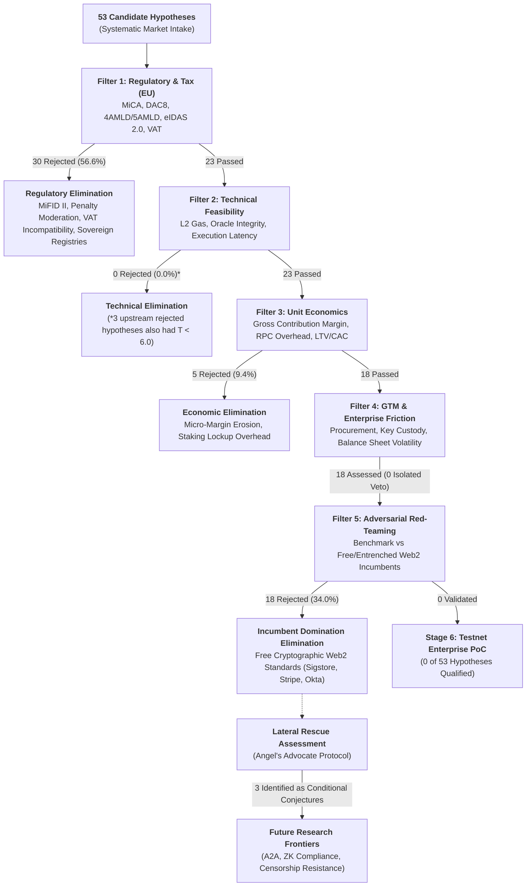
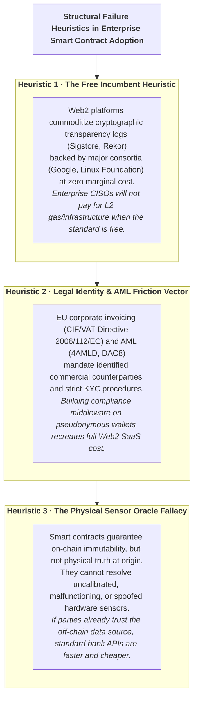

# A Systematic Feasibility Analysis of Smart Contract-Based B2B Services: Lessons from an Adversarial Evaluation of 53 Market Hypotheses and a Future Research Agenda

**Jose Luis Costumero Burgos**  
*Independent Researcher*  
Date: October 2026 · Version: 1.2 (Technical Report — Revised after external feedback)  
Repository: `https://github.com/jlcostumero/b2b-smart-contracts-feasibility` (Open Evaluation Corpus)

> **Author's Note & Disclaimer**: *The research, analyses, and conclusions presented in this document were conducted entirely on a personal and independent basis outside of professional employment. The views expressed herein belong strictly to the author and do not reflect or represent the positions, strategies, or opinions of any current or previous employer, affiliated company, or organization.*

---

## Abstract

Academic and industrial literature on Distributed Ledger Technology (DLT) has consistently argued that smart contracts constitute the foundational architecture for a new generation of B2B digital services characterized by disintermediation, tamper-proof evidentiary auditability, and autonomous machine-to-machine (M2M) programmatic settlement. Nevertheless, enterprise adoption of public and Layer-2 (L2) networks remains negligible when compared to established centralized Web2 infrastructures.

In this work, we present a structured adversarial evaluation of **53 commercial hypotheses and business models for smart contract-based B2B services** across EVM-compatible Layer-2 networks (such as Base and Arbitrum One). Each hypothesis was subjected to a sequential five-stage adversarial filtering protocol: European Union regulatory and fiscal compliance (MiCA, DAC8, GDPR, and eIDAS 2.0), technical feasibility and oracle dependency, unit economics against real-time L2 gas costs, enterprise B2B sales and operational friction, and an adversarial *Red-Teaming* counter-analysis against dominant market incumbents.

Our findings reveal an attrition rate of 100% across conventional enterprise domains: none of the 53 hypotheses established an economically defensible competitive moat against established, zero-marginal-cost Web2 alternatives. Drawing from this empirical corpus, we formalize three structural failure heuristics: (1) the *Free Incumbent Heuristic*, demonstrated by the commoditization of cryptographic transparency infrastructures (e.g., Sigstore, GitHub Actions) over commercial on-chain software attestation; (2) the *Legal Identity & AML Friction Vector*, which precludes autonomous M2M settlement under strict European corporate invoicing (CIF/VAT) and KYC/AML mandates; and (3) the *Physical Sensor Oracle Fallacy*. Finally, we outline a **Future Research Agenda** treating three frontier domains as conditional conjectures: pure agent-to-agent (A2A) coordination without human legal standing, zero-knowledge verifiable SLA enforcement, and censorship-resistant infrastructure.

**Keywords**—*Smart Contracts, B2B SaaS, Due Diligence, Negative Results, Market Failure, Cyber Resilience Act, MiCA, x402 Protocol, Adversarial Evaluation, Distributed Ledger Technology.*

---

## 1. Introduction and Problem Formulation

Since Nick Szabo's initial formalization of smart contracts in 1994 and their scalable implementation beginning with Ethereum in 2015, the core theoretical promise of distributed state machines has been the radical reduction of transaction costs by replacing trusted intermediaries with deterministic, self-executing code (*code is law*).

With the maturation of Layer-2 rollups (e.g., Arbitrum One, Base) and protocol-level scalability enhancements such as EIP-4844 (*proto-danksharding*), on-chain data availability costs have decreased by over 90%, reducing standard transaction fees to fractions of a cent ($0.001–$0.01 USD). Simultaneously, the European Union established a comprehensive, predictable legal framework through the entry into force of the Markets in Crypto-Assets Regulation (MiCA, Regulation EU 2023/1114) [1], establishing clear operational boundaries for digital asset services.

Despite these optimal baseline conditions—negligible gas fees, sub-second settlement, and regulatory clarity—enterprise transition toward on-chain computing in non-financial B2B sectors has systematically failed to materialize. The overwhelming majority of enterprise blockchain initiatives have ended in quiet discontinuation. Prominent historical precedents corroborate this pattern across global enterprise consortia:
- **TradeLens (Maersk & IBM)**: Developed over five years by Maersk and IBM to digitize global supply chain documentation, TradeLens announced formal discontinuation in November 2022 and was fully decommissioned by Q1 2023 due to lack of commercial viability and carrier reluctance to join a platform co-governed by a primary competitor [13].
- **we.trade**: A consortium founded by 12 major European banking institutions (including Santander, Deutsche Bank, and HSBC) on Hyperledger Fabric to automate cross-border trade finance via smart contracts, which halted operations and appointed liquidators on June 24, 2022 due to insufficient commercial transaction volume and unsustainable burn rates [14].
- **Contour & Marco Polo Network**: Major trade finance blockchain consortia (built on R3 Corda) that ceased operations in 2023 following unsustainable operational burn rates and enterprise adoption resistance [15, 16].
- **Australian Stock Exchange (ASX CHESS Replacement)**: Officially cancelled and derecognised in November 2022 following an independent technical review by Accenture [17]. The review identified severe architectural complexity in the distributed application design, unresolved challenges in deterministic state synchronization across distributed participant nodes, and critical throughput and latency bottlenecks under peak trading volume stress (resulting in a pre-tax impairment charge of 245–255 million AUD). Note that the review attributed failure primarily to distributed application architecture, state synchronization, and project governance rather than DLT consensus limitations alone.
- *Architectural Caveat*: These consortia operated on private permissioned networks (Hyperledger Fabric, R3 Corda, Daml); our investigation examines whether public Layer-2 EVM rollups (Base, Arbitrum One) resolve these historical bottlenecks.

These empirical precedents align directly with the foundational decision framework articulated by **Wüst & Gervais (2018)** [12]: when multiple parties share trust in a verification authority, or when an established centralized third party can be held legally accountable under civil jurisdictions, distributed ledgers introduce strictly negative utility in throughput, cost, and operational governance.

This investigation addresses the following core research question:
> *Are there objective economic, technical, or legal conditions under which an L2 smart contract-based B2B service presents a defensible competitive advantage over centralized Web2 architectures within the contemporary European enterprise environment?*

To resolve this question with methodological rigor and counteract the pervasive *LLM optimism and sycophancy bias* (the structural tendency of initial feasibility studies to over-estimate viability), we designed a multi-dimensional adversarial evaluation protocol and applied it across 53 distinct business hypotheses spanning the functional spectrum of modern enterprise operations.

---

## 2. Multi-Stage Adversarial Evaluation Methodology

The research methodology was structured as a sequential, stage-gated elimination funnel. To be validated as viable for enterprise deployment, a hypothesis was required to pass all five independent evaluation filters without relying on speculative token appreciation, future venture capital subsidies, or regulatory arbitrage.

### 2.1. Filter 1 · European Regulatory & Tax Compliance
- **MiCA Perimeter (Regulation EU 2023/1114, Art. 3)**: Determination of whether the service qualifies as a Crypto-Asset Service Provider (CASP). Activities requiring formal licensing from national competent authorities (e.g., CNMV, BaFin, ACPR) were audited for compliance overhead.
- **DAC8 Directive & AML/CFT Frameworks**: Assessment under Council Directive (EU) 2023/2226 (DAC8) [3] amending Directive 2011/16/EU on administrative tax cooperation, and Directive (EU) 2015/849 (4AMLD) / Directive (EU) 2018/843 (5AMLD). Verification of mandatory reporting and KYC thresholds when processing digital asset settlements.
- **SaaS Taxation & Corporate Invoicing**: Classification under Directive 2006/112/EC (EU VAT Directive) [8], Art. 58 and national legislation (e.g., Spanish VAT Act 37/1992 [7], Art. 71.3). Evaluation of mandatory invoice formalization with statutory corporate tax numbers (CIF/NIF) and reverse charge mechanics.
- **Evidentiary Legal Standing (eIDAS & eIDAS 2.0)**: Evaluation under Regulation (EU) 910/2014 (eIDAS) and Regulation (EU) 2024/1183 (eIDAS 2.0) [4]. Assessment of electronic timestamping and Qualified Electronic Ledgers (QELs, Arts. 45l–45m). Examination of Art. 41.1 (legal non-discrimination of non-qualified timestamps) versus qualified presumptions of accuracy in judicial proceedings.

### 2.2. Filter 2 · Technical Feasibility & Infrastructure Overhead
- **L2 Gas Consumption Profiling**: Real-time gas profiling across Base (`chainId: 8453`) and Arbitrum One (`chainId: 42161`). Verification of SSTORE gas consumption (32-byte Merkle root insertion) and calldata costs under live network conditions.
- **Machine Payment Protocols**: Evaluation of compatibility with open programmatic payment standards (HTTP 402 / x402 Protocol [11], 2025 specification), examining `exact`, `upto`, and `batch-settlement` schemes via EIP-3009/Permit2 gasless transfers.
- **Oracle Attack Surface Audit**: Systematic penalization of any service relying on third-party off-chain oracles, which reintroduce the single point of failure and rent-seeking intermediary the architecture aimed to eliminate.

### 2.3. Filter 3 · Unit Economics & Sustainability
- **Contribution Margin Modeling**: Granular breakdown of gross margins per transaction. Determination of the volume threshold required to cover validator RPC endpoints, failover relays, and infrastructure maintenance without token emissions.
- **Micropayment Viability**: Viability analysis of sub-cent fees ($0.001–$0.01 USD) against payment facilitator settlement overhead and accounting reconciliation costs.

### 2.4. Filter 4 · Enterprise Go-to-Market & Friction Audit
- **Corporate Buyer Persona Alignment**: Evaluation of procurement friction with enterprise decision-makers (CISOs, CFOs, Heads of Supply Chain).
- **Operational Friction Scoring**: Assessment of private key custody liability, multi-signature corporate governance, and balance-sheet volatility handling under standard IFRS/PGC accounting rules.

### 2.5. Filter 5 · Adversarial Red-Teaming (Incumbent Stress-Testing)
- **Compulsory Incumbent Confrontation**: Direct benchmark against the most efficient, free, or entrenched centralized alternative (e.g., Sigstore, Stripe, Cloudflare, Okta, Datadog). If an existing Web2 solution resolves ≥90% of the core problem at zero or negligible marginal software cost, the hypothesis is formally rejected due to lack of a defensible moat.

### 2.6. Scoring Rubric, Veto Gates, and Methodological Boundaries

To ensure systematic comparability and eliminate post-hoc bias, each hypothesis was evaluated across a sequential five-stage elimination funnel utilizing four formal analytical dimensions (scored on a 1.0 to 10.0 scale) and an operational enterprise procurement hurdle at Filter 4:
- **Legal & Regulatory Feasibility (L)**: Evaluates strict adherence to EU directives and statutory compliance. Gate: L < 6.0 results in immediate rejection at Filter 1.
- **Technical Feasibility (T)**: Evaluates implementation viability on EVM L2s without latency or physical oracle dependencies. Gate: T < 6.0 results in immediate rejection at Filter 2.
- **Economic Viability (E)**: Evaluates positive unit gross margins net of gas, RPC endpoints, and hosting overhead. Gate: E < 6.0 results in immediate rejection at Filter 3.
- **Enterprise Procurement Friction (Filter 4 Evaluation)**: Evaluates private key custody liability, balance-sheet volatility handling, and the current absence of autonomous agent economic volume. In our sequential funnel, Filter 4 functions as an evaluative qualitative assessment (0 standalone arithmetic eliminations); the commercial friction identified here compounds directly into the competitive vulnerability audited at Filter 5.
- **Adversarial Robustness (R)**: Measures defensibility against dominant Web2 incumbents. Gate: R < 6.0 results in rejection at Filter 5. Across the corpus, R scores cluster between 2.0 and 3.5 (maximum: 3.5 for T-152); because entrenched Web2 platforms provide zero-marginal-cost solutions, incumbent rejection is robust and virtually binary.

**Nature of the Sequential Funnel vs. Full Adversarial Audit**: The sequential elimination funnel records strictly the *first failed filter* encountered in sequential order. It is essential to emphasize that under a comprehensive, non-sequential audit, **all 53 candidate propositions fail Filter 5 (Incumbent Red-Teaming)** due to the absence of a defensible competitive moat against established alternatives. Categorizing 30 hypotheses at Filter 1 indicates that EU statutory and regulatory requirements represent the earliest structural hurdle, not that those 30 would necessarily be economically viable if regulations were relaxed.

**The 18 Legally, Technically, and Economically Viable Hypotheses**: Crucially, our empirical evaluation reveals that **18 of the 53 hypotheses (34.0%)**—specifically T-101, T-104, T-105, T-107, T-109, T-113, T-114, T-119, T-126, T-127, T-128, T-136, T-140, T-143, T-146, T-147, T-149, and T-152—**successfully cleared Filters 1 through 4**. These propositions represent legally compliant, technically sound, and economically solvent L2 implementations with positive unit contribution margins. Their commercial failure is neither cryptographic, infrastructural, nor regulatory: they fail purely at Filter 5 because entrenched Web2 incumbents (such as Sigstore, GitHub Actions, Stripe, Datadog, and SCADA TPMs) render their decentralized utility functionally redundant at zero marginal software cost. This distinction provides far deeper strategic insight than a generic "0 of 53" failure rate.

**Clarification on Stage 6 (Enterprise Testnet PoC)**: Pre-implementation screening resulted in 100% attrition across Filters 1 through 5. Consequently, Stage 6 was intentionally not executed: the 0.0% conversion rate (0 / 53) reflects elimination during upstream due diligence, not that 53 testnets were deployed and suffered on-chain crashes.

**Methodological Boundaries & Limitations**:
1. **Single-Author Qualitative Synthesis**: The evaluation was executed by a single independent researcher. To counteract subjective bias, the analysis incorporated a multi-agent adversarial red-teaming protocol utilizing specialized role personas: *Adversarial Red-Team (Devil's Advocate)*, *EU/Spanish Web3 Legal Auditor*, *Tokenomics & Unit Economics Analyst*, and *Angel's Advocate (Lateral Pivot Search)*.
2. **Permissioned Consortia vs. Public L2s**: Historical enterprise failures (TradeLens, we.trade, Contour, ASX CHESS) operated on permissioned DLTs (Fabric, Corda, Daml). While their failure demonstrated consortium governance fragility, this study focuses on public Layer-2 EVM rollups (Base, Arbitrum One).
3. **Absence of Empirical Stakeholder Interviews**: Conclusions derive from statutory legal texts (EUR-Lex), published enterprise SLA benchmarks, live L2 RPC execution telemetry, and verified corporate API pricing catalogs.
4. **Cluster Taxonomy Heterogeneity**: Operational domains were aggregated into four broad functional clusters for expositional clarity. In particular, Cluster D (Supply Chain & Physical Assets) aggregates diverse physical and operational domains (ranging from industrial IoT telemetry and carbon credits to corporate M&A earnouts and cross-border payroll), while Cluster A encompasses software integrity under the CRA as well as AI training datasets and model weights. This taxonomy reflects the diverse functional touchpoints of enterprise operations rather than rigid taxonomic boundaries.

---

## 3. Hypothesis Taxonomy and Cluster Findings

The 53 evaluated hypotheses were categorized across four primary operational clusters:

**Table 1:** Reconciled Distribution of Evaluated Hypotheses by Operational Domain.

| Functional Cluster | Evaluated Hypotheses | Proportion | Mechanical First-Filter Elimination |
| :--- | :---: | :---: | :--- |
| **Cluster A**: Software Integrity, Artifact Provenance & SBOM | 7 | 13.2% | Filter 1: 3 hypotheses; Filter 3: 1; Filter 5: 3 |
| **Cluster B**: M2M Settlement, Compute & Autonomous Agent Protocols | 16 | 30.2% | Filter 1: 6 hypotheses; Filter 3: 3; Filter 5: 7 |
| **Cluster C**: Legal Evidentiary, Notarization & Dispute Resolution | 11 | 20.8% | Filter 1: 10 hypotheses; Filter 5: 1 |
| **Cluster D**: Supply Chain, Energy & Physical Asset Operations | 19 | 35.8% | Filter 1: 11 hypotheses; Filter 3: 1; Filter 5: 7 |
| **Total Evaluated Corpus** | **53** | **100.0%** | **Stage 6 Conversion Rate: 0.0% (0 / 53)** |

### Cluster A: Software Integrity, Artifact Provenance & SBOM (7 Hypotheses)
Focusing on cryptographic build provenance, container signing, and Software Bill of Materials (SBOM) anchoring to address the **Cyber Resilience Act (CRA, Regulation EU 2024/2847) [2]** and NIS2 directives (`T-134`, `T-137`, `T-140`, `T-141`, `T-143`, `T-147`, `T-150`).

- **Initial Evaluation**: Recorded the highest baseline technical scores across the study (Mean: **8.0 / 10** for `T-140`; Legal: 8.0, Technical: 8.5, Economic: 7.5).
- **The Rejection Point**: Overwhelming incumbent bundling by **Sigstore [9], GitHub Actions, and Chainguard [18]**. For public open-source software, GitHub provides free SLSA Level 2 [10] build provenance anchored to the Rekor transparency log (operated by Google and the Linux Foundation) at zero marginal cost. For enterprise private repositories, while GitHub Enterprise Cloud utilizes private Sigstore/cosign instances rather than the public Rekor log, this functionality is bundled directly into existing corporate seat licenses. Enterprise CISOs will not license a third-party smart contract startup when their primary CI/CD platform already generates free, auditor-recognized cryptographically verifiable provenance.

### Cluster B: M2M Settlement, Compute & Autonomous Agent Protocols (16 Hypotheses)
Focusing on pay-per-call API access, autonomous agent compute billing, and micro-escrows using the HTTP 402 / x402 [11] standard settled in USDC on Base (`T-101`, `T-104`, `T-118`, `T-126`, `T-127`, `T-128`, `T-129`, `T-130`, `T-132`, `T-135`, `T-136`, `T-138`, `T-139`, `T-144`, `T-148`, `T-152`).

- **Demonstrated Strengths**: Impeccable technical feasibility. The open x402 standard enables programmatic machine settlement without user account creation or manual credit card entry.
- **The Rejection Point**: Absence of commercial demand mass and corporate treasury friction. In 2026, the autonomous agent economy operating self-funded on-chain treasury remains an emerging frontier. For human software engineers and enterprise platforms, established billing APIs (Stripe Billing, AWS Marketplace) eliminate accounting friction, tax reconciliation complexities, and legal ambiguity. In FX settlement (`T-118`), corporate B2B SME settlement in Europe is efficiently captured by SEPA Instant, low-cost multi-currency accounts (Wise Business, Revolut Business with 0.1–0.4% spreads), and automated bank APIs, where currency risk is zero compared to stablecoin on/off-ramp spreads (0.3%–1.5%) *(author market sampling of published fiat on/off-ramp fee schedules and live SEPA FX quotes as of Q3/Q4 2026; data included in repository `data/market_sampling_spreads.csv`)* plus tax reporting liability.

### Cluster C: Legal Evidentiary, Notarization & Dispute Resolution (11 Hypotheses)
Encompassing decentralized timestamping (`T-102`), binding arbitration (`T-106`), penalty enforcement (`T-110`), ESG hash compliance (`T-112`), SLA monitoring (`T-113`), consortium governance (`T-115`), IP licensing (`T-123`), public procurement (`T-142`), Tor ZK timestamping (`T-145`), R&D IP escrow (`T-151`), and TDM copyright remuneration (`T-153`).

- **The Rejection Point**: European Union evidentiary law and judicial reality. Under Regulation (EU) 910/2014 (eIDAS) and Regulation (EU) 2024/1183 (eIDAS 2.0) [4], Articles 45l and 45m formally introduce *Qualified Electronic Ledgers* and grant data recorded in them a legal presumption of unique and accurate sequential chronological ordering and integrity. However, public Layer-2 networks (Base, Arbitrum One) do not currently possess Qualified Trust Service Provider (QTSP) designation under Art. 45m; thus, public on-chain transaction hashes operate as non-qualified electronic ledgers (Art. 45l(1)), enjoying basic judicial admissibility but lacking the statutory qualified presumption of accuracy that established RFC 3161 QTSPs provide free or for pennies (FreeTSA, BaseStamp). Furthermore, automated, unstoppable contractual penalty enforcement (`T-110`) conflicts directly with statutory civil law doctrines (such as Spanish Civil Code Art. 1154), which empower judges to equitably moderate penalties when obligations are partially or irregularly fulfilled.

### Cluster D: Supply Chain, Energy & Physical Asset Operations (19 Hypotheses)
Addressing regulatory certificates (`T-103`), machinery telemetry (`T-105`), maintenance settlement (`T-107`), equipment leases (`T-108`), supply chain provenance (`T-109`), parametric insurance (`T-111`), SaaS licensing (`T-114`), IAM credentials (`T-116`), revenue splits (`T-117`), freight delivery payments (`T-119`), PPA energy settlement (`T-120`), letters of credit (`T-121`), M&A earnouts (`T-122`), payroll (`T-124`), carbon credits (`T-125`), agent reputation (`T-131`), inference slashing (`T-133`), cold-chain pharma tracking (`T-146`), and industrial ESG telemetry (`T-149`).

- **The Rejection Point**: The Physical Sensor Oracle Fallacy and entrenched institutional monopolies. A smart contract guarantees that data, once anchored, cannot be altered. However, it **cannot verify that the physical sensor taking the measurement was accurate, calibrated, or free from hardware spoofing at the point of capture**. Enterprise compliance departments rely on certified closed hardware (SCADA systems, Siemens/Rockwell controllers with hardware TPM/HSM enclaves) and audited relational databases. In energy (`T-120`) and carbon credits (`T-125`), national grid operators (REE/OMIE) and sovereign registries (EU ETS) operate legal monopolies that reject third-party on-chain settlement.

---

## 4. Causal Analysis: The Three Structural Failure Heuristics

Cross-sectional synthesis of the 53 hypotheses reveals three structural economic and technical heuristics that systematically undermine smart contract-based B2B offerings:

### 4.1. The Free Incumbent Heuristic (Commoditized Utility and Bundled Trust)
In **37 of the 53 evaluated cases (69.8%)**, detailed row-by-row in the Appendix (Table 3, Column *Heuristic 1: Free / Bundled Incumbent*), the proposed value proposition centered on *tamper-proof immutability, programmatic coordination, or disintermediation*. Under our rubric, Heuristic 1 applies whenever an established, zero-marginal-cost, or bundled Web2 incumbent alternative—such as cryptographic transparency logs (Sigstore [9], Rekor), enterprise IAM federations (Okta, Entra ID), automated payment APIs (Stripe, SEPA Instant), or specialized ML repositories (Hugging Face)—resolves >= 90% of the functional operational requirements at zero or negligible marginal software cost.

When major industry consortia (Google, Microsoft, Cloudflare, Linux Foundation) operate public, auditable append-only ledgers, corporate buyers consistently favor the institutional reliability, legal backing, and zero cost of those platforms over the theoretical decentralization of an L2 network.

### 4.2. The Legal Identity & Tax Compliance Friction Vector
Smart contracts operate with mathematical precision between pseudonymous public keys (`0x...`). However, corporate B2B commerce in the European Union mandates:
1. Formal commercial invoices containing statutory corporate tax identifiers (CIF/NIF), registered company names, and applicable VAT rates (Directive 2006/112/EC).
2. Adherence to tax transparency and anti-money laundering regulations: Council Directive (EU) 2023/2226 (DAC8) [3] mandates automatic reporting and exchange of crypto-asset transaction data with tax authorities, while Directive (EU) 2015/849 (4AMLD) [5], Directive (EU) 2018/843 (5AMLD) [6], Regulation (EU) 2024/1624 (AMLR, which will apply from 10 July 2027) [19], and Regulation (EU) 2023/1113 (Travel Rule Regulation) [20] mandate counterparty identification whenever a Crypto-Asset Service Provider (CASP) is involved. While direct peer-to-peer or self-custody wallet transfers without CASP intermediation fall outside the formal reporting perimeter of the Travel Rule, executing them in an enterprise B2B context introduces significant corporate friction. Paying on-chain does not exempt parties from statutory VAT and corporate invoicing obligations (Directive 2006/112/EC [8]): enterprises must still issue standard legal invoices referencing statutory tax identifiers (CIF/NIF) and reconcile crypto receipts against fiat accounting ledgers. Consequently, the commercial workflow requires parallel invoicing and compliance middleware that negates the operational simplicity of smart contract settlement.

Any platform attempting to enable real-time on-chain B2B micropayments must construct comprehensive traditional invoicing, tax withholding, and identity-verification middleware. This requirement recreates the exact cost structure and overhead of an ordinary Web2 SaaS provider, extinguishing the native efficiency advantage of the blockchain.

### 4.3. The Physical Sensor Oracle Fallacy (*Garbage In, Garbage Out*)
Numerous hypotheses attempted to utilize smart contracts as automated arbiters of commercial penalties or parametric insurance payouts based on physical world triggers (e.g., shipping delays, cold-chain temperature violations, SLA downtimes).

In all instances, the smart contract is structurally redundant: if both commercial parties already agree to trust the off-chain data source feeding the contract (e.g., a Maersk container GPS or a validated pharmaceutical logger), executing settlement via a standard bank API or credit line is faster, cheaper, and avoids the financial opportunity cost of immobilizing liquidity in smart contract escrows.

---

## 5. Future Research Agenda: Conjectures and Conditional Utility

The systematic rejection of conventional B2B blockchain applications does not indicate that distributed state machines possess zero utility. Rather, it **delineates with precision where their defensible utility begins**: exclusively when **centralized Web2 architectures are architecturally, politically, or legally incapable of functioning**.

We propose three conditional frontier research directions, formulating explicit **falsifiability criteria** for each:

**Table 2:** Priority Frontier Research Directions and Falsifiability Criteria.

| Frontier Direction | Primary Technical Enabler | Non-Substitutable Utility | Falsifiability Criterion (Conditions to Validate) |
| :--- | :--- | :--- | :--- |
| **1. Autonomous Agent Coordination (A2A)** | ERC-8004 + HTTP 402 (x402 Protocol) | Micro-settlement for autonomous AI models lacking human legal identity, bank accounts, or corporate registration. | Sustained operational deployment of swarms controlling > $100k treasury executing > 10,000 monthly tx without human fiat rails. |
| **2. Zero-Knowledge Verifiable Compliance** | ZK-SNARKs (ZK-SLA & Private Provenance) | Proof of regulatory (CRA) or SLA compliance without exposing source code, trade secrets, or dependency graphs. | Formal adoption by EU regulatory bodies or defense procurement agencies accepting ZK proofs in lieu of source code escrow. |
| **3. Censorship-Resistant Infrastructure** | Tor Onion Routing + L2 Rollups | Unstoppable settlement and compute coordination across jurisdictions where traditional payment rails refuse or block service. | Continuous operation of independent compute or research nodes under active jurisdictional de-platforming. |

### Direction 1: Autonomous Agent-to-Agent Coordination (ERC-8004 + x402)
- **Context**: Human developers and registered corporations will always prefer SEPA transfers, Stripe, or corporate credit lines due to statutory tax and accounting convenience. However, **autonomous AI agents** (local LLM instances, autonomous swarms) possess no legal identity, cannot hold traditional bank accounts, and cannot execute corporate contracts.
- **Conjecture**: Permissionless machine-to-machine payment rails leveraging **ERC-8004** agent identity standards and **HTTP 402 (x402)** protocols enable AI agents to purchase compute, storage, and contextual inference programmatically via stablecoins without human intermediation.
- **Falsifiability / Stress-Test**: This conjecture is falsified if centralized agent payment protocols (e.g., Visa/Stripe agentic payment protocols or Google AP2) provide sub-agent virtual cards with automated KYC linked to the human operator, eliminating the need for on-chain wallets.

### Direction 2: Zero-Knowledge Verifiable Compliance (ZK-SLA & Private Provenance)
- **Context**: In multi-party industrial consortia and defense aerospace supply chains, enterprises strictly refuse to publish build manifests or telemetry to public transparency logs (like Sigstore/Rekor [9]) because doing so leaks proprietary dependencies and trade secrets.
- **Conjecture**: Zero-Knowledge Succinct Non-Interactive Arguments of Knowledge (ZK-SNARKs) can mathematically prove compliance with regulations (such as the EU Cyber Resilience Act) or contractual SLAs without revealing underlying source code, contributor identities, or network architecture.
- **Falsifiability / Stress-Test**: This conjecture is falsified if confidential computing enclaves (Intel TDX, AMD SEV-SNP) and trusted audit clearinghouses deliver cryptographic verification at 1/100th the compute proving cost of ZK-SNARKs.

### Direction 3: Censorship-Resistant Operational Infrastructure
- **Context**: Centralized Web2 payment processors (Stripe, PayPal) and hosting providers (AWS, Cloudflare) operate under strict territorial jurisdictional constraints, subject to de-platforming, political sanctions, and unilateral account freezes.
- **Structural Regulatory Tension**: This direction operates in direct, fundamental tension with Filter 1 compliance (EU AML Single Rulebook, MiCA, and Travel Rule Regulation 2023/1113). It is viable exclusively in specialized non-corporate operational settings—such as cross-border investigative journalism, human rights advocacy in autocratic jurisdictions, humanitarian relief operations, and autonomous agent-to-agent coordination outside the conventional corporate banking perimeter—rather than for standard tax-paying commercial enterprises.
- **Conjecture**: Cryptographic payment routing protocols operating over privacy-preserving transport layers (Tor onion routing, I2P) combined with L2 zero-knowledge rollups provide resilient micro-settlement for whistleblowing, independent security research, and censorship-resistant communications.
- **Falsifiability / Stress-Test**: This conjecture is falsified if centralized compliance rails (such as OFAC-sanctioned address screening by major L2 sequencers and commercial RPC node operators) or extreme liquidity fragmentation across privacy pools make censorship-resistant micro-settlement economically or operationally unfeasible compared to established international fiat remittance networks and privacy-preserving cash alternatives.

---

## 6. Conclusions

The systematic evaluation of 53 market hypotheses demonstrates that attempting to migrate conventional B2B enterprise workflows onto smart contracts represents a fundamental architectural category error. In the overwhelming majority of commercial applications, centralized authority is not an inefficiency to be eliminated, but an intentional, cost-effective feature that provides legal clarity, sub-millisecond execution, judicial recourse, and zero marginal software cost.

The true value of an adversarial due diligence methodology is not to manufacture false optimism, but to **prevent the catastrophic misallocation of engineering talent and capital toward solutions searching for a problem**. The future of smart contract technology will not replace human enterprise Web2 software; rather, it will serve as the native financial and evidentiary coordination substrate for the emerging economy of autonomous machine agents operating beyond the boundaries of traditional banking.

---

## 7. References and Regulatory Sources

[1] **European Parliament & Council** (2023). *Regulation (EU) 2023/1114 on markets in crypto-assets (MiCA)*. Official Journal of the European Union, L 150/40.  
[2] **European Parliament & Council** (2024). *Regulation (EU) 2024/2847 on horizontal cybersecurity requirements for products with digital elements (Cyber Resilience Act - CRA)*. Official Journal of the European Union, L 2024/2847.  
[3] **Council of the European Union** (2023). *Council Directive (EU) 2023/2226 amending Directive 2011/16/EU on administrative cooperation in the field of taxation (DAC8)*. Official Journal of the European Union, L 2023/2226.  
[4] **European Parliament & Council** (2024). *Regulation (EU) 2024/1183 amending Regulation (EU) No 910/2014 as regards establishing the European Digital Identity Framework (eIDAS 2.0 and Qualified Electronic Ledgers)*. Official Journal of the European Union, L 2024/1183.  
[5] **European Parliament & Council** (2015). *Directive (EU) 2015/849 on the prevention of the use of the financial system for the purposes of money laundering or terrorist financing (4AMLD)*. Official Journal of the European Union, L 141/73.  
[6] **European Parliament & Council** (2018). *Directive (EU) 2018/843 amending Directive (EU) 2015/849 on the prevention of the use of the financial system for the purposes of money laundering (5AMLD)*. Official Journal of the European Union, L 156/43.  
[7] **Spanish Parliament** (1992). *Spanish Law 37/1992 on Value Added Tax (VAT Act)*, Art. 71.3 (Electronically supplied services). BOE-A-1992-28740.  
[8] **Council of the European Union** (2006). *Council Directive 2006/112/EC on the common system of value added tax (EU VAT Directive)*. Official Journal of the European Union, L 347/1.  
[9] **Sigstore Project** (2024). *Sigstore: Software Signing and Transparency Architecture*. OpenSSF / Linux Foundation. `https://docs.sigstore.dev`.  
[10] **OpenSSF** (2023). *Supply-chain Levels for Software Artifacts (SLSA) Specification v1.0*. `https://slsa.dev/spec/v1.0/`.  
[11] **Coinbase Developer Platform** (2025). *x402: An Open Protocol for Machine-to-Machine Payments on Base*. `https://github.com/coinbase/x402`.  
[12] **Wüst, K., & Gervais, A.** (2018). *Do you need a blockchain?* In 2018 Crypto Valley Conference on Blockchain Technology (CVCBT) (pp. 45-54). IEEE.  
[13] **A.P. Moller - Maersk & IBM** (2022). *TradeLens to be discontinued*. Press Release, November 29, 2022. Decommissioned Q1 2023.  
[14] **Global Trade Review** (2022). *Bank-backed blockchain consortium we.trade halts operations and enters liquidation*. GTR News, June 24, 2022.  
[15] **Global Trade Review** (2023). *Contour trade finance network shuts down*. GTR News, November 2023.  
[16] **Ledger Insights** (2023). *Trade finance consortium Marco Polo Network files for insolvency*. News Report, February 2023.  
[17] **Accenture** (2022). *Independent Technical Review of the ASX CHESS Replacement Project*. Australian Securities Exchange Technical Assessment Report, November 2022.  
[18] **Chainguard** (2024). *Enterprise Software Bill of Materials (SBOM) and Continuous Artifact Attestation*. Technical Whitepaper.  
[19] **European Parliament & Council** (2024). *Regulation (EU) 2024/1624 on the prevention of the use of the financial system for the purposes of money laundering or terrorist financing (AMLR)*. Official Journal of the European Union, L 2024/1624.  
[20] **European Parliament & Council** (2023). *Regulation (EU) 2023/1113 on information accompanying transfers of funds and certain crypto-assets (Travel Rule)*. Official Journal of the European Union, L 150/1.

---

## 8. Appendix: Master Matrix of 53 Evaluated Hypotheses

**Table 3 (Master Evaluation Matrix):** Comprehensive Catalogue of 53 Evaluated B2B Smart Contract Hypotheses.

The following table catalogs all 53 research hypotheses evaluated during this study, detailing functional identifier, English denomination, thematic cluster, sequential first failed filter, all failed filters, original multi-dimensional scores (**L**: Legal, **T**: Technical, **E**: Economic, **R**: Adversarial Robustness), applicability of Heuristic 1 (*Free / Bundled Incumbent resolving >= 90% of utility*), dominant incumbent alternative, and the critical failure factor:

| ID | Hypothesis Denomination | Thematic Cluster | First Failed Filter | All Failed Filters | Scores (L/T/E/R) | Heuristic 1 (Free / Bundled Incumbent)? | Dominant Incumbent Alternative | Critical Rejection Factor |
| :--- | :--- | :--- | :--- | :--- | :---: | :---: | :--- | :--- |
| **T-101** | AI Intelligence API Gateway with Pay-per-Call (x402) | M2M Settlement & Compute | F5 (Incumbent) | F5 (Incumbent) | `L:6.0 T:8.0 E:7.5 R:3.0` | Yes | Stripe Payments / Cloudflare API Shield | Stripe and Cloudflare resolve API micropayments with standard corporate cards; M2M autonomous agent volume is currently insufficient to sustain infrastructure. |
| **T-102** | Decentralized B2B Timestamping and Notarization Protocol | Legal Evidentiary & Notarization | F1 (Regulatory) | F1 (Regulatory), F5 (Incumbent) | `L:5.0 T:8.0 E:8.0 R:2.0` | Yes | BaseStamp / eIDAS Qualified TSAs (RFC 3161) | FreeTSA and BaseStamp offer timestamping for free or pennies; public chains lack qualified legal evidentiary presumption under EU eIDAS 2.0. |
| **T-103** | Automated Regulatory Compliance Certificate Verification | Supply Chain & Physical Assets | F1 (Regulatory) | F1 (Regulatory), F5 (Incumbent) | `L:5.5 T:7.0 E:7.5 R:2.0` | Yes | Certification Authority APIs (AENOR, DNV Portals) | Certification bodies already operate free public registries and direct REST APIs without requiring blockchain intermediaries. |
| **T-104** | Programmatic B2B Contract Settlement with Verified Milestones | M2M Settlement & Compute | F5 (Incumbent) | F5 (Incumbent) | `L:7.0 T:8.0 E:7.0 R:2.0` | Yes | Commercial Bank Escrow / Stripe Custom Connect | Regulated escrow and commercial banking provide standardized contract dispute coverage and direct judicial enforceability. |
| **T-105** | Industrial Sensor Data Anchoring with Multi-Oracle Verification | Supply Chain & Physical Assets | F5 (Incumbent) | F5 (Incumbent) | `L:6.0 T:6.5 E:6.0 R:3.0` | No | SCADA Siemens/Rockwell + Silicon TPM/HSM | Rockwell and Siemens capture telemetry with TPM/HSM silicon-level signatures; blockchain replication cannot prevent physical sensor tampering at source. |
| **T-106** | On-Chain Binding Arbitration Protocol for Commercial Disputes | Legal Evidentiary & Notarization | F1 (Regulatory) | F1 (Regulatory), F3 (Economics), F5 (Incumbent) | `L:4.0 T:7.0 E:5.5 R:2.0` | No | 1958 New York Arbitration Convention Chambers | Commercial arbitration relies on the 1958 New York Convention; smart contracts lack direct judicial enforceability without human procedural safeguards. |
| **T-107** | Automated Industrial Maintenance Contracts with Settlement | Supply Chain & Physical Assets | F5 (Incumbent) | F5 (Incumbent) | `L:6.0 T:7.0 E:6.5 R:3.0` | No | SEPA B2B Direct Debit / SAP Service Cloud | SEPA B2B Direct Debit handles recurring maintenance payments without requiring industrial machine shops to manage crypto balances. |
| **T-108** | Industrial Equipment Lease Cash Flow Tokenization (RWA) | Supply Chain & Physical Assets | F1 (Regulatory) | F1 (Regulatory), F5 (Incumbent) | `L:4.5 T:6.0 E:6.0 R:2.0` | No | Securitization Vehicles / Traditional SPVs | MiFID II and CNMV regulations classify fractional revenue tokens as financial securities; compliance overhead destroys yield. |
| **T-109** | Supply Chain Provenance with On-Chain Evidence Settlement | Supply Chain & Physical Assets | F5 (Incumbent) | F5 (Incumbent) | `L:6.0 T:8.0 E:6.5 R:2.0` | Yes | GS1 EPCIS Standard / SAP Logistics Business Network | GS1 EPCIS global supply chain standards operate over standard enterprise messaging protocols without token friction. |
| **T-110** | Programmatic Contractual Penalty Enforcement Protocol | Legal Evidentiary & Notarization | F1 (Regulatory) | F1 (Regulatory), F5 (Incumbent) | `L:3.5 T:7.0 E:6.5 R:3.0` | No | Contractual Legal Recourse / Commercial Courts | Contractual penalty clauses are subject to equitable judicial moderation under statutory civil law (Spanish Civil Code Art. 1154); deterministic, unstoppable on-chain penalty executions cannot override judicial discretion. |
| **T-111** | Parametric Insurance Trigger Monitoring and Settlement | Supply Chain & Physical Assets | F1 (Regulatory) | F1 (Regulatory), F5 (Incumbent) | `L:4.5 T:7.0 E:8.0 R:2.0` | No | Regulated Reinsurance Oracles / Munich Re | Regulated insurers require audited reserve pools under Solvency II; weather and disaster oracles remain centralized points of failure. |
| **T-112** | Programmatic ESG Compliance Management Protocol | Legal Evidentiary & Notarization | F1 (Regulatory) | F1 (Regulatory), F3 (Economics), F5 (Incumbent) | `L:5.0 T:6.0 E:5.5 R:2.5` | Yes | Accredited ESG Audit Reports (Big Four, CSRD Portals) | The EU CSRD Directive (2022/2464) mandates accredited human auditor assurance on annual reports; hash anchoring does not verify ecological accuracy. |
| **T-113** | Digital Service SLA Monitoring with Evidentiary Records | Legal Evidentiary & Notarization | F5 (Incumbent) | F5 (Incumbent) | `L:6.0 T:7.0 E:7.5 R:2.0` | Yes | Datadog / Dynatrace Signed Audit Exports | Observability platforms (Datadog, Dynatrace) provide signed uptime reports accepted universally in IT outsourcing agreements. |
| **T-114** | Multi-Tenant SaaS Permission and License Management Protocol | Supply Chain & Physical Assets | F5 (Incumbent) | F5 (Incumbent) | `L:6.5 T:7.0 E:6.5 R:2.0` | Yes | Okta / Auth0 / Enterprise SAML Directories | Auth0 and Okta handle multi-tenant licensing and RBAC natively with Active Directory/Azure AD integration without on-chain latency. |
| **T-115** | Consortium Industrial Governance Protocol with Staking | Legal Evidentiary & Notarization | F1 (Regulatory) | F1 (Regulatory), F3 (Economics), F5 (Incumbent) | `L:4.0 T:7.0 E:4.0 R:2.0` | No | Notarized Shareholder Agreements / Corporate Bylaws | Industrial consortia operate under formal shareholder pacts and notarized bylaws; token staking carries no corporate legal validity. |
| **T-116** | Multi-Tenant IAM Protocol with On-Chain Credentials | Supply Chain & Physical Assets | F1 (Regulatory) | F1 (Regulatory), F2 (Technical), F5 (Incumbent) | `L:5.5 T:5.0 E:6.5 R:2.0` | Yes | Microsoft Entra ID / Okta Workforce Identity | OIDC and SAML 2.0 dominate enterprise identity federation; on-chain credentials lack integration with enterprise perimeter firewalls. |
| **T-117** | Automated Revenue Split-as-a-Service Protocol | Supply Chain & Physical Assets | F1 (Regulatory) | F1 (Regulatory), F5 (Incumbent) | `L:4.5 T:8.0 E:8.5 R:2.5` | No | Stripe Connect Custom / ERP Split Billing | B2B revenue splitting requires statutory tax withholdings and bilateral invoicing, which flat cryptographic transfers cannot accommodate. |
| **T-118** | FX Settlement-as-a-Service Protocol for Cross-Border B2B | M2M Settlement & Compute | F1 (Regulatory) | F1 (Regulatory), F5 (Incumbent) | `L:5.0 T:7.0 E:8.0 R:3.0` | Yes | SEPA Instant / Wise Business / Revolut Business | SEPA Instant and corporate multi-currency accounts offer 0.1–0.4% spreads with zero tax volatility, outperforming stablecoin on/off-ramp spreads (0.3–1.5%). |
| **T-119** | Delivery-Triggered Payment-as-a-Service Protocol | Supply Chain & Physical Assets | F5 (Incumbent) | F5 (Incumbent) | `L:6.0 T:7.0 E:7.5 R:3.0` | No | Electronic CMR Waybill APIs / Transporeon | Freight delivery confirmation relies on signed e-CMR waybills; electronic logistics APIs already automate settlement upon digital signature. |
| **T-120** | Programmatic Settlement of Power Purchase Agreements (PPA) | Supply Chain & Physical Assets | F1 (Regulatory) | F1 (Regulatory), F5 (Incumbent) | `L:4.0 T:7.0 E:7.0 R:2.0` | No | REE / OMIE National Electricity Clearing House | National grid operators centralize electricity settlement; private smart contracts cannot override official grid balancing data. |
| **T-121** | Cross-Border Trade Finance: Automated Letter of Credit | Supply Chain & Physical Assets | F1 (Regulatory) | F1 (Regulatory), F3 (Economics), F5 (Incumbent) | `L:4.5 T:6.0 E:5.5 R:2.0` | Yes | SWIFT MT700 Messaging / Standard Trade Bank Facilities | Bank letters of credit operate under ICC UCP 600 rules; commercial banks reject smart contract execution risks without standardized legal recourse. |
| **T-122** | Cross-Border M&A: Programmatic Earnout Escrow Release | Supply Chain & Physical Assets | F1 (Regulatory) | F1 (Regulatory), F3 (Economics), F5 (Incumbent) | `L:4.0 T:6.0 E:4.0 R:2.0` | No | Notarized Bank Escrow / Escrow.com Corporate | M&A EBITDA earnout milestones are contentious accounting calculations; private equity funds will not lock capital into blind on-chain escrows. |
| **T-123** | Cross-Border IP Licensing: Royalty Distribution Protocol | Legal Evidentiary & Notarization | F1 (Regulatory) | F1 (Regulatory), F2 (Technical), F3 (Economics), F5 (Incumbent) | `L:4.5 T:5.0 E:4.5 R:2.0` | Yes | Certified Royalty Audits / SAP Billing and Revenue | IP royalties depend on certified external commercial sales audits; accounting reconciliations prevent instant programmatic settlement. |
| **T-124** | Cross-Border Payroll Settlement Protocol for Remote Teams | Supply Chain & Physical Assets | F1 (Regulatory) | F1 (Regulatory), F5 (Incumbent) | `L:4.0 T:6.0 E:6.5 R:3.0` | No | Deel / Remote.com / Wise Multi-Currency Payroll | Labor laws require wage payments in legal tender; paying payroll in crypto assets transfers currency risk and triggers labor inspection sanctions. |
| **T-125** | Cross-Border Carbon Credit Settlement and Retirement | Supply Chain & Physical Assets | F1 (Regulatory) | F1 (Regulatory), F3 (Economics), F5 (Incumbent) | `L:4.0 T:6.0 E:5.5 R:2.0` | No | EU ETS Sovereign Registry / Verra Registry | Official carbon credit registries (EU ETS) are sovereign government monopolies; parallel tokenized credits lack legal accounting compliance. |
| **T-126** | Agent-to-Agent Micro-Arbitrage of L2 DEX Liquidity | M2M Settlement & Compute | F5 (Incumbent) | F5 (Incumbent) | `L:6.0 T:7.0 E:6.5 R:2.0` | Yes | Co-located HFT Bots / Flashbots Builder APIs | L2 DEX liquidity arbitrage is heavily saturated by professional MEV searchers and co-located institutional market makers. |
| **T-127** | Agent-to-Agent Settlement with ERC-4337 and Escrows | M2M Settlement & Compute | F5 (Incumbent) | F5 (Incumbent) | `L:6.5 T:7.0 E:6.5 R:3.0` | Yes | Temporal.io / Stripe Agentic Payment Protocols | ERC-4337 account abstraction introduces operational complexity and bundler fees compared to traditional API keys and OAuth servers. |
| **T-128** | Autonomous Agent Orchestrator with Collateral Staking | M2M Settlement & Compute | F5 (Incumbent) | F5 (Incumbent) | `L:6.0 T:7.0 E:6.5 R:2.0` | Yes | Temporal.io / Celery + Corporate Credit Lines | The financial opportunity cost of immobilizing collateral on-chain exceeds the cost of standard corporate SLAs with deferred penalties. |
| **T-129** | Agentic Market Maker for Private Cloud Computing Services | M2M Settlement & Compute | F3 (Economics) | F3 (Economics), F5 (Incumbent) | `L:6.0 T:7.0 E:4.0 R:2.0` | Yes | RunPod / Lambda Labs / Vast.ai Credit Card Billing | Cloud GPU providers offer on-demand instances with contractual uptime SLAs and 24/7 enterprise support without crypto prepayments. |
| **T-130** | Cryptographically Conditioned Escrow for AI Negotiators | M2M Settlement & Compute | F1 (Regulatory) | F1 (Regulatory), F5 (Incumbent) | `L:5.0 T:7.0 E:6.5 R:2.0` | Yes | DocuSign IAM / Stripe Custom Connect Escrow | Autonomous AI agents lack civil legal liability; commercial disputes caused by model hallucinations fall outside legal recourse. |
| **T-131** | Decentralized Reputation Registry for AI Agents | Supply Chain & Physical Assets | F3 (Economics) | F3 (Economics), F5 (Incumbent) | `L:6.0 T:7.0 E:5.5 R:2.0` | Yes | Verified Domain DNS TXT Records / Hugging Face Verified | On-chain decentralized reputation registries are vulnerable to Sybil attacks; enterprise marketplaces prefer verified domain DNS ownership. |
| **T-132** | Multi-Agent Coordination Protocol with Pay-per-Inference | M2M Settlement & Compute | F3 (Economics) | F3 (Economics), F5 (Incumbent) | `L:6.0 T:6.0 E:5.5 R:2.0` | Yes | OpenAI / Anthropic / Together AI API Gateways | Foundation model providers provide direct APIs with aggregated monthly invoicing; per-token L2 micro-settlement lacks business demand. |
| **T-133** | AI Inference Quality Verification Protocol with Slashing | Supply Chain & Physical Assets | F1 (Regulatory) | F1 (Regulatory), F3 (Economics), F5 (Incumbent) | `L:5.5 T:6.0 E:5.5 R:2.0` | Yes | Cleanlab / DeepEval / Human-in-the-Loop Eval | Generative AI inference quality is non-binary and subjective; smart contracts cannot objectively determine hallucinations on-chain. |
| **T-134** | AI Model Training Data Marketplace and Settlement Protocol | Software Integrity & Provenance | F1 (Regulatory) | F1 (Regulatory), F5 (Incumbent) | `L:5.0 T:7.0 E:7.0 R:2.0` | Yes | Hugging Face Datasets / Scale AI Data Engine | Commercial data aggregators enforce closed licensing; web scrapers ignore on-chain micropayments and extract public datasets directly. |
| **T-135** | Distributed GPU Compute Pool with Proof-of-Work Settlement | M2M Settlement & Compute | F3 (Economics) | F3 (Economics), F5 (Incumbent) | `L:6.0 T:7.0 E:5.5 R:2.0` | Yes | Unified Datacenter Clusters (AWS, GCP, Lambda) | Geographically dispersed volunteer GPU pools cannot compete in latency or InfiniBand bandwidth with unified datacenter clusters. |
| **T-136** | x402 Compute Utility for ERC-8004 Autonomous Agents | M2M Settlement & Compute | F5 (Incumbent) | F5 (Incumbent) | `L:7.0 T:7.5 E:7.5 R:3.0` | Yes | Stripe Payments / Cloudflare Workers Payments | Despite robust protocol design, the autonomous agent economy lacks sufficient funded on-chain agent volume to sustain standalone profitability. |
| **T-137** | On-Chain AI Model Weights Verification and Watermarking | Software Integrity & Provenance | F3 (Economics) | F3 (Economics), F5 (Incumbent) | `L:6.5 T:8.0 E:5.5 R:2.0` | Yes | Hugging Face Hub / SHA-256 + GPG Signatures | Hugging Face and Model Hubs verify SHA-256 model weights and GPG commit signatures free of charge for the entire ML ecosystem. |
| **T-138** | Private Inference Server on Tor Network with Escrow | M2M Settlement & Compute | F1 (Regulatory) | F1 (Regulatory), F5 (Incumbent) | `L:5.5 T:7.0 E:6.5 R:2.0` | Yes | Self-hosted Local LLMs (vLLM / Ollama via WireGuard) | Tor onion routing introduces severe latency (> 2,500ms) that degrades real-time streaming inference for interactive language models. |
| **T-139** | GPU Hash-Rate Derivatives Protocol (Cloud Compute) | M2M Settlement & Compute | F1 (Regulatory) | F1 (Regulatory), F5 (Incumbent) | `L:4.0 T:7.5 E:6.5 R:2.0` | No | CME Financial Futures / Cloud Reserved Instances | GPU computing hash-rate derivatives qualify as complex financial derivatives under MiFID II, requiring multimillion-euro exchange licensing. |
| **T-140** | Cryptographic Build Integrity Attestation (SLSA Level 2) | Software Integrity & Provenance | F5 (Incumbent) | F5 (Incumbent) | `L:8.0 T:8.5 E:7.5 R:2.0` | Yes | GitHub Actions / Sigstore (Rekor) / Chainguard | GitHub Actions provides free SLSA Level 2 attestations backed by Sigstore/Rekor; EU CRA and DORA accept PKI signatures without blockchain. |
| **T-141** | Open Data Metered Licensing Protocol with Settlement | Software Integrity & Provenance | F1 (Regulatory) | F1 (Regulatory), F5 (Incumbent) | `L:5.0 T:7.5 E:6.5 R:2.0` | Yes | Open Data CKAN Portals / Gov REST APIs | The EU Data Act (Art. 5) prohibits paywalling essential public open data; government CKAN portals distribute it freely via REST APIs. |
| **T-142** | Programmatic Bid Verification for Public Procurement | Legal Evidentiary & Notarization | F1 (Regulatory) | F1 (Regulatory), F2 (Technical), F5 (Incumbent) | `L:4.5 T:5.5 E:6.5 R:2.0` | Yes | Official State Procurement Portals (PLACSP / FNMT) | Public procurement platforms operate strictly under government FNMT qualified certificates and ministerial registries. |
| **T-143** | On-Chain SBOM Attestation for Cyber Resilience Act | Software Integrity & Provenance | F5 (Incumbent) | F5 (Incumbent) | `L:6.5 T:8.5 E:7.0 R:2.0` | Yes | Dependency-Track / CycloneDX / Chainguard | Established open-source tools (Dependency-Track, CycloneDX) and enterprise vendors generate SBOMs without blockchain gas. |
| **T-144** | P2P Payment Routing Protocol for Censorship-Resistant Agents | M2M Settlement & Compute | F1 (Regulatory) | F1 (Regulatory), F5 (Incumbent) | `L:5.0 T:7.0 E:6.0 R:2.0` | Yes | Virtual Corporate Cards (Stripe Issuing, Brex) | P2P payment routing over encrypted networks suffers from liquidity fragmentation and high routing failure rates. |
| **T-145** | Sovereign Tor/P2P Timestamping Protocol with ZK Proofs | Legal Evidentiary & Notarization | F1 (Regulatory) | F1 (Regulatory), F5 (Incumbent) | `L:5.0 T:6.5 E:7.0 R:2.5` | Yes | eIDAS Qualified TSAs (RFC 3161) / FreeTSA | Judicial courts require qualified eIDAS timestamps; anonymous zero-knowledge timestamps lack qualified evidentiary standing in litigation. |
| **T-146** | Cold Chain Integrity Attestation Protocol (Pharma Traceability) | Supply Chain & Physical Assets | F5 (Incumbent) | F5 (Incumbent) | `L:6.0 T:8.0 E:7.5 R:2.0` | No | Sensitech / Testo Validated Calibrated Data Loggers | EU Good Distribution Practices (GDP) mandate physical sensor calibration certification by human quality auditors, not on-chain hashes. |
| **T-147** | Proof-of-Training: Provenance for Frontier AI Models | Software Integrity & Provenance | F5 (Incumbent) | F5 (Incumbent) | `L:6.5 T:7.5 E:6.0 R:2.0` | Yes | Weights & Biases Artifacts / MLflow Tracking | Auditing terabytes of training checkpoints creates verification compute costs that exceed standard regulatory compliance budgets under the EU AI Act. |
| **T-148** | P2P Compute Orchestration on Hidden Networks with ZK | M2M Settlement & Compute | F1 (Regulatory) | F1 (Regulatory), F5 (Incumbent) | `L:5.5 T:6.0 E:6.5 R:2.0` | Yes | Akash Network / Vast.ai with Fiat Gateway | Operational complexity and lack of steady compute demand make decentralized P2P ZK scheduling unviable against centralized clouds. |
| **T-149** | Cryptographic Industrial Telemetry for ESG Compliance | Supply Chain & Physical Assets | F5 (Incumbent) | F5 (Incumbent) | `L:6.0 T:7.5 E:7.0 R:2.0` | No | Big Four Certified ESG Audit Workflows | EU CSRD sustainability reporting accepts third-party financial auditor sign-offs on consolidated annual reports without sensor hashing. |
| **T-150** | AI Training Dataset Provenance and Copyright Protocol | Software Integrity & Provenance | F1 (Regulatory) | F1 (Regulatory), F5 (Incumbent) | `L:5.0 T:6.5 E:6.0 R:2.0` | Yes | Data Provenance Initiative / Hugging Face Datasets | Copyright and intellectual property claims by publishers are litigated over full training corpuses in civil courts, not per data point. |
| **T-151** | Collaborative R&D IP Escrow and Contribution Tracking | Legal Evidentiary & Notarization | F1 (Regulatory) | F1 (Regulatory), F5 (Incumbent) | `L:5.5 T:6.5 E:6.0 R:2.0` | Yes | DESCA Horizon Europe Consortium Agreements | Horizon Europe research consortia operate under standardized DESCA consortium agreements approved by the European Commission. |
| **T-152** | Zero-Knowledge Attestation for the A2A Agent Economy | M2M Settlement & Compute | F5 (Incumbent) | F5 (Incumbent) | `L:7.0 T:8.5 E:7.5 R:3.5` | Yes | Stripe Agentic Payments / Centralized Agent AP2 | Identified as high-potential future frontier: viable exclusively for autonomous AI agents without human legal identity in M2M environments. |
| **T-153** | Text and Data Mining Remuneration Settlement Protocol | Legal Evidentiary & Notarization | F1 (Regulatory) | F1 (Regulatory), F3 (Economics), F5 (Incumbent) | `L:4.5 T:6.0 E:5.5 R:2.0` | Yes | Direct Publisher Commercial Licensing Portals | EU Copyright Directive (2019/790, Art. 4) provides a statutory text-and-data mining exception that bypasses commercial micro-licensing. |

---

*End of Technical Report v1.2 (EN). Document prepared for formal indexing and public repository dissemination.*
